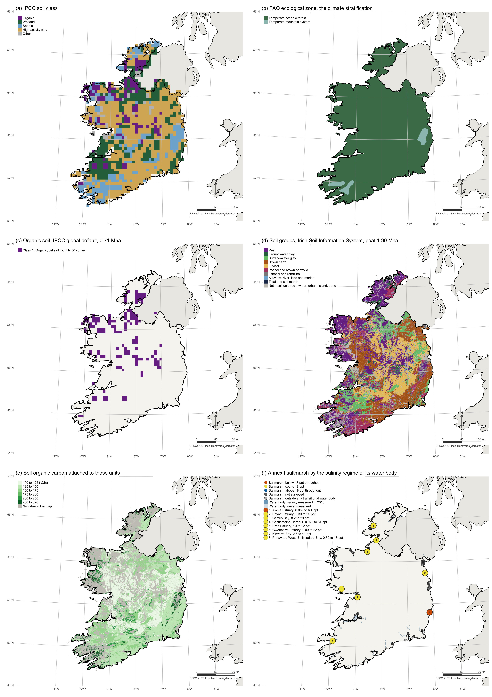
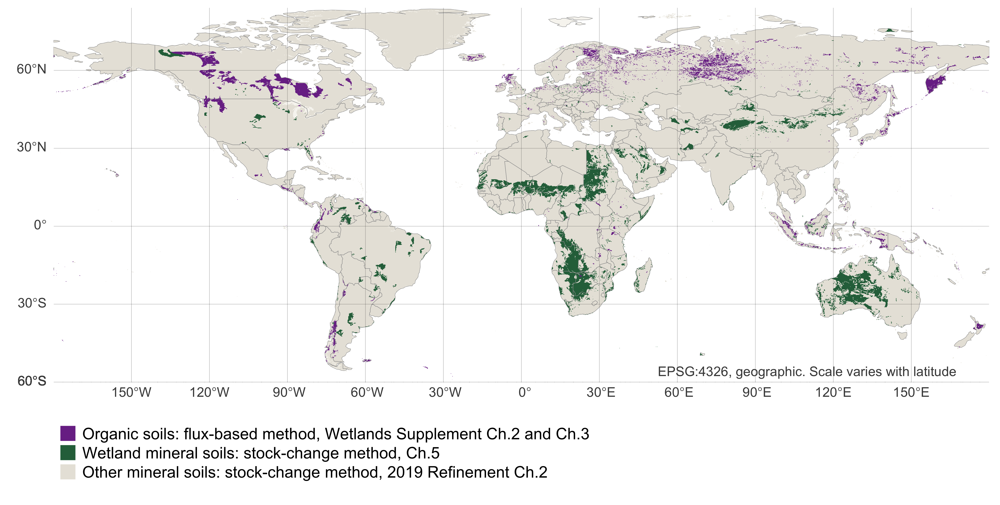

```{r}
#| label: setup
#| out-width: "100%"
#| echo: false

# Base R only. No external packages beyond knitr, so the document renders anywhere.
options(stringsAsFactors = FALSE, scipen = 999)

# Figures are written as PNGs to 03.outputs/figures/ as a side effect of rendering, so the
# same files the document displays are the ones available for slides and the README. Base
# graphics only, consistent with the no-dependencies rule.
knitr::opts_chunk$set(echo = FALSE, fig.path = "../03.outputs/figures/",
                      dev = "png", dpi = 600, fig.width = 9, fig.height = 5.5)

PAL <- c(pos = "#2C6E49", neg = "#A4303F", mid = "#7A7A7A", hi = "#1D3557", lo = "#E9C46A")

# Unit conversions used throughout.
# Area-weighted mean, used by the reference-stock and Irish soils sections.
wmean <- function(x, w) sum(x * w) / sum(w)
# Small counts and ratios are written as words in prose; larger ones stay as digits.
num_word <- function(n) {
  n <- round(n)
  w <- c("one","two","three","four","five","six","seven","eight","nine","ten","eleven","twelve")
  if (n >= 1 && n <= 12) w[n] else as.character(n)
}

C_TO_CO2 <- 44 / 12      # tonnes CO2 per tonne C
CH4C_TO_CH4 <- 16 / 12   # tonnes CH4 per tonne CH4-C
N_TO_N2O <- 44 / 28      # tonnes N2O per tonne N2O-N
```

# 1 Introduction

Since 2013, a country can report a soil carbon gain on three kinds of land at once under the IPCC methods, a rewetted peatland, a restored coastal wetland and an improved grassland, and no study has set those gains side by side on one greenhouse-gas-weighted axis. This paper assembles them, encodes the default tables that produce them, tests each gain against the methane and nitrous oxide the same land emits at a hundred-year and a twenty-year horizon, and uses the factors Ireland has measured for the same pathways to test the defaults against a national dataset. The hypothesis is that the gains these methods allow a country to report are not climate benefits on a substantial share of pathways, for three reasons. National reporting weighs the gases at a single 100-year horizon and never sets a pathway's gain against its own methane and nitrous oxide. The gain and the penalty last for different lengths of time, and the printed uncertainty of the defaults cannot show how far they lie from a measured national value.

The methods are recent and unrevised, in that the 2013 Wetlands Supplement replaced Equations 2.24 and 2.26 of the 2006 Guidelines, which had "implicitly assumed that organic soils can only lose carbon", with an Equation 3.1 under which a rewetted organic soil removes carbon, the first negative Tier 1 emission factors in the history of the guidelines [@ipcc2006; @blain2014]. The same Supplement lets a restored tidal marsh or mangrove accumulate soil carbon "as long as the soil remains rewetted and vegetated", to a stock ceiling roughly two centuries away [@kennedy2014], and lets a rewetted wetland mineral soil recover its stock over forty years [@wickland2014]. The 2019 Refinement kept the improved grassland factors of 1.14 and 1.17 that have stood since @ogle2004 [@mcconkey2019], rebuilt the reference stocks they multiply from the profile compilation of @batjes2011 [@ogle2019], and answered its own peatland chapter with the words "No refinement", so every drained and rewetted factor in force today is the 2013 factor [@lovelock2019]. Annex 1 to Volume 4 of the Refinement records those as the only changes to the two tables this paper runs, the reference stocks and the grassland factors [@ipcc2019refinement].

A gain reported under these methods is not the same thing as a benefit to the atmosphere, and the guidance gives no way to tell them apart. The Wetlands Supplement calculates each gas in its own equation and applies no greenhouse gas weighting anywhere in its 354 pages. The reporting rules of the Paris Agreement supply the weighting, requiring each country to add its gases at 100-year global warming potentials and to report the uncertainty of its totals [@unfccc2019]. Other metrics are optional, and no rule asks for the net of a single pathway, its carbon dioxide removal set against the methane or nitrous oxide the same land emits. The choice of metric is itself a policy decision, which the IPCC methodology reports do not make and AR6 Box 7.3 declines to recommend [@forster2021]. The gain and the penalty also last for different lengths of time, since coastal accumulation runs to a stock ceiling, inland mineral wetland recovery to forty years, mineral soil management to twenty and organic soil rewetting with no end, while the methane and nitrous oxide from the same hectares never stop. @petersson2024 define what a removal must satisfy before it counts as mitigation, a progressive increase in a site's stock over the pre-intervention condition by net transfer of carbon dioxide from the atmosphere, and none of it is satisfied by a default table alone. @wilson2016, written by the Supplement's own authors, did the subtraction that test requires at GWP-100 for inland organic soils and found large benefits for most land uses with one negative case, temperate nutrient-rich Forest Land, and @zhang2025 then showed by Monte Carlo on United Kingdom peatlands that the horizon alone turns one restoration step from a near certainty into a 42.2 per cent chance of increasing emissions under GWP-20, and their GWP\* implementation is adopted in section 2.2. No study has taken the coastal, mineral wetland and grassland pathways through the same test, or asked how long each gain may be claimed against a penalty that never stops.

The defaults themselves are least certain in exactly the pools studied here. The rewetted temperate factors of Supplement Table 3.1 have 95 per cent bounds that span zero on carbon dioxide and start at zero on methane [@blain2014], the seagrass accumulation factor rests on six observations [@kennedy2014], and the boreal wetland mineral methane factor of Supplement Table 5.4 rests on one study with an interval as wide as its mean [@wickland2014]. The 2019 Refinement warns that such defaults "can have inherently high uncertainties, particularly bias, when applied to specific countries" and that bias "is not necessarily captured in the uncertainty range" [@domke2019], because a printed range says how well a global average is known and not how far it lies from the soil being reported. The only way to find that distance is to measure the soil, as @villarino2018 did in the Argentinean Semiarid Chaco by deriving country-specific stock change factors instead of propagating the defaults, and as Ireland has done for its organic soils by deriving Tier 2 factors from a national flux compilation [@aitova2023], which allows the default and the measurement to be compared on the same hectares.

Two findings result, the first being that on the organic soil pathways the sign of the benefit of rewetting is set by the emission metric and horizon rather than by the emission factor for five of thirteen land use, climate and nutrient combinations, and that the same five fail a 95 per cent probability threshold when the published bounds are resampled. The second is that on the mineral soil pathways the reference stocks every gain scales from lie above the median of their own source profiles in 34 of 37 cells. That excess reflects right-skewed profiles, and it does not show that national gains are inflated, since the mean is the right value for a national total. It matters for a parcel or project, where the typical soil holds less carbon than its default. The interval printed beside each stock is the precision of a global mean rather than the range a single parcel faces. The bias the 2019 Refinement warns about is the difference between a default and the land it is applied to. Ireland shows it directly, since its country-specific factors differ from the defaults in opposite directions for the two gases on the same land.

## 1.1 Terminology

Two distinctions apply throughout, the first being that flux-based accounting, area multiplied by an annual emission factor, applies to organic soils only. Mineral soil is instead stock-change, because Equation 2.25 of the 2019 Refinement differences two modelled equilibrium stocks and divides by a transition period [@ogle2019]. There is no flux-based Tier 1 or Tier 2 method for improved grassland. Separately, there is no reference stock (`SOCref`) for peat, because Batjes excluded organic soils by design [@batjes2011]. That exclusion is the structural reason the two accounting logics coexist and must be reported separately rather than summed.

# 2 Methods

The IPCC reports removals as negative and emissions as positive. For legibility, gains in this manuscript are reported as positive tonnes of carbon dioxide equivalent per hectare per year removed, and the sign is stated in every table caption. Sign conventions are treated as contractual, so that no quantity changes sign between a chunk and its caption.

## 2.1 Baselines

A rewetted organic soil emits methane and is a net source in absolute terms in every climate zone and nutrient class, which is a property of wet peat rather than a finding. The hypothesis concerns the *intervention*, so the quantity of interest is the difference between the rewetted state and the drained state it replaces, written as

::: {custom-style="IPCC Equation"}
$$\text{Benefit} = \text{Net flux}_{\text{drained}} - \text{Net flux}_{\text{rewetted}}$$ {#eq-benefit}
:::

Reporting the absolute rewetted flux as a result would invert the published conclusion of @wilson2016 and contradict @gunther2020; the absolute fluxes therefore enter as model inputs only, and nowhere as findings.

## 2.2 Emission factors

Because the Supplement performs no weighting and AR6 recommends no single metric, results are reported under GWP-100 for comparability with inventory practice and under GWP-20 to expose the near-term methane penalty. @allen2022, signed by both sides of the GWP\* dispute, recommend reporting short-lived and long-lived gases separately rather than choosing between metrics, and that position is followed here, so the set of metrics is a sensitivity rather than a claim about which metric is correct. The AR6 values used throughout are given in Table S1. The GWP\* weighting of a methane flux $E$ follows the implementation of @zhang2025 and is defined in @eq-gwpstar, under which a step change in a sustained flux is charged heavily for twenty years and a flux aged past that window is charged 0.28 of its GWP-100 value.

::: {custom-style="IPCC Equation"}
$$E_{\text{CO}_2\text{we}}(t) = \left[\,4.53\,E(t) - 4.25\,E(t-20)\,\right] \cdot \text{GWP}_{100}$$ {#eq-gwpstar}
:::

```{r}
#| label: metrics
#| out-width: "100%"
#| echo: false
#| output: false

# AR6 WGI Table 7.15, values including carbon-cycle and chemical responses.
GWP <- data.frame(
  gas    = c("CH4_fossil", "CH4_nonfossil", "N2O"),
  gwp20  = c(82.5, 79.7, 273),
  gwp100 = c(29.8, 27.0, 273),
  gtp100 = c(7.5, 4.7, 233)
)

g100_ch4 <- GWP$gwp100[GWP$gas == "CH4_nonfossil"]
g20_ch4  <- GWP$gwp20[GWP$gas == "CH4_nonfossil"]
g100_n2o <- GWP$gwp100[GWP$gas == "N2O"]

# GWP* after Smith, Cain & Allen (2021), as implemented by Zhang et al. (2025):
#   E_CO2we = (4.53 * E(t) - 4.25 * E(t-20)) * GWP100
# Defined here and reported as a sensitivity; a step change to a sustained flux, aged
# past the 20-year window, is charged 0.28 x GWP100 rather than 1.00 x GWP100.
gwp_star <- function(e_now, e_lag20, gwp100 = g100_ch4) {
  (4.53 * e_now - 4.25 * e_lag20) * gwp100
}

cat(sprintf("Sustained CH4 flux under GWP*: %.2f x GWP100, versus 1.00 x GWP100 under GWP-100.\n",
            gwp_star(1, 1) / g100_ch4))
```

## 2.3 Reference mineral soils

Table 2.3 of the 2019 Refinement supplies the reference condition stock `SOCref`, 0 to 30 cm, under native vegetation [@ogle2019]. The same table number in the Wetlands Supplement carries the drained methane factors, so the two are named by their document wherever both could be meant.

```{r}
#| label: socref
#| out-width: "100%"
#| echo: false
#| output: false

# IPCC 2019 Refinement Vol.4 Ch.2 Table 2.3 (UPDATED).
# value = t C/ha 0-30 cm; err = 95% CI as % of mean; n = profiles.
socref <- read.csv(text = "
zone,soil,value,err,n
C2,HAC,43,8,177
C2,LAC,33,90,NA
C2,SAN,13,33,10
C2,VOL,20,90,NA
C2,WET,87,90,NA
C1,HAC,81,5,334
C1,LAC,76,51,6
C1,SAN,51,13,126
C1,POD,128,14,45
C1,VOL,136,14,28
C1,WET,128,13,42
W2,HAC,24,5,781
W2,LAC,19,16,41
W2,SAN,10,5,338
W2,VOL,84,65,10
W2,WET,74,17,49
W1,HAC,64,5,489
W1,LAC,55,8,183
W1,SAN,36,23,39
W1,POD,143,30,9
W1,VOL,138,12,42
W1,WET,135,28,28
T4,HAC,21,5,554
T4,LAC,19,10,135
T4,SAN,9,9,164
T4,VOL,50,90,NA
T4,WET,22,17,32
T3,HAC,40,7,226
T3,LAC,38,5,326
T3,SAN,27,12,76
T3,VOL,70,90,NA
T3,WET,68,17,55
T2,HAC,60,8,137
T2,LAC,52,6,271
T2,SAN,46,20,43
T2,VOL,77,27,14
T2,WET,49,19,33
T1,HAC,51,10,114
T1,LAC,44,11,84
T1,SAN,52,34,11
T1,VOL,96,31,10
T1,WET,82,50,12
")

zone_names <- c(
  C2 = "Cool temp dry", C1 = "Cool temp moist",
  W2 = "Warm temp dry", W1 = "Warm temp moist",
  T4 = "Tropical dry", T3 = "Tropical moist",
  T2 = "Tropical wet", T1 = "Tropical montane"
)

cat(sprintf("Table 2.3 cells encoded: %d of the published table, spanning %d climate zones and %d soil classes. Polar and Boreal rows are not encoded.\n",
            nrow(socref), length(unique(socref$zone)), length(unique(socref$soil))))
cat(sprintf("Stated error ranges from +/-%d%% to +/-%d%%.\n",
            min(socref$err), max(socref$err)))

# Cells with no profile count are the ones Table 2.3 footnotes 3 and 4 carry forward from
# the 1996 and 2006 Guidelines with a nominal +/-90% error; Batjes (2011) has no data for them.
n_legacy <- sum(is.na(socref$n))
cat(sprintf("Cells retained from earlier guidance rather than taken from Batjes (2011): %d.\n", n_legacy))
```

Of the `r nrow(socref)` cells used here, `r nrow(socref) - n_legacy` are the arithmetic means of the profile compilation of @batjes2011, and the remaining `r num_word(n_legacy)`, for which that compilation had no data, take values retained from earlier guidance with a nominal error of ±90%. The cells span the Cool temperate, Warm temperate and Tropical zones, with stated 95 per cent errors from ±5% to ±90% of the mean; the Polar and Boreal rows are not included, and the consequence is set out in section 4.5. The stock change method those cells feed is Equation 2.25 of the 2019 Refinement, reproduced below in the form the guidance prints it [@ogle2019].

::: {custom-style="IPCC Equation"}
**EQUATION 2.25** [Annual change in organic carbon stocks in mineral soils]{.smallcaps}

$$\Delta C_{\text{Mineral}} = \frac{SOC_{0} - SOC_{(0-T)}}{D}$$

$$SOC = \sum_{c,s,i}\left(SOC_{\text{REF}_{c,s,i}} \cdot F_{\text{LU}_{c,s,i}} \cdot F_{\text{MG}_{c,s,i}} \cdot F_{\text{I}_{c,s,i}} \cdot A_{c,s,i}\right)$$

Where\
$\Delta C_{\text{Mineral}}$ = annual change in organic C stocks in mineral soils, tonnes C yr^-1^\
$SOC_{0}$ = mineral soil organic C stock in the last year of an inventory time period, tonnes C\
$SOC_{(0-T)}$ = mineral soil organic C stock at the beginning of the inventory time period, tonnes C\
$T$ = number of years over a single inventory time period, yr\
$D$ = time dependence of the stock change factors, the default period for transition between equilibrium SOC values, commonly 20 years, yr\
$SOC_{\text{REF}}$ = reference carbon stock, tonnes C ha^-1^\
$F_{\text{LU}}$, $F_{\text{MG}}$, $F_{\text{I}}$ = stock change factors for land use, management and input, dimensionless\
$A$ = land area of the stratum, ha; $c$, $s$, $i$ = climate zone, soil type and management system
:::

## 2.4 Improved grasslands

The improved grassland pathway is Equation 2.25 run in the gain direction, and since `F_LU` is 1.0 for all grassland in all climates, the compound factor is `F_MG * F_I` and the whole gain reduces to one coefficient [@ogle2019; @mcconkey2019]. The annual gain per hectare therefore reduces to @eq-grass.

::: {custom-style="IPCC Equation"}
$$G = SOC_{\text{REF}} \cdot \left(F_{\text{MG}}^{\text{improved}} \cdot F_{\text{I}} - F_{\text{MG}}^{\text{start}}\right) \cdot \frac{44}{12} \cdot \frac{1}{D}$$ {#eq-grass}
:::

Table 6.2 of the 2019 Refinement lists fertilisation as a qualifying improvement [@mcconkey2019], and fertilisation produces nitrous oxide, which is annual and open-ended, while the soil carbon gain is capped at `D` years by Equation 2.25. The penalty per kilogram of nitrogen applied combines the direct factor with the volatilisation and leaching pathways of Chapter 11 of the 2019 Refinement [@ipcc2019refinement] (@eq-npenalty), and because the cumulative gain saturates at $D \cdot G$ while the penalty accrues without limit, the crossover year and the break-even rate follow from it (@eq-crossover).

::: {custom-style="IPCC Equation"}
$$p = \left[EF_{1} + Frac_{\text{GASF}} \cdot EF_{4} + Frac_{\text{LEACH}} \cdot EF_{5}\right] \cdot \frac{44}{28} \cdot \text{GWP}_{100,\,\text{N}_2\text{O}}$$ {#eq-npenalty}
:::

::: {custom-style="IPCC Equation"}
$$t^{*} = \frac{D \cdot G}{N \cdot p / 1000}, \qquad N_{\text{break-even}} = \frac{1000 \cdot G}{p}$$ {#eq-crossover}
:::

## 2.5 Rewetted soil factors

Chapter 3 of the Wetlands Supplement applies from the year of rewetting with no transition period [@blain2014]. Its factors are composite, covering soil and non-tree vegetation together, and are set out with their published bounds in Table S2. The balance the chapter reports is Equation 3.1, the equation that first allowed a rewetted organic soil to be reported as a removal [@blain2014].

::: {custom-style="IPCC Equation"}
**EQUATION 3.1** [Net gains or losses of C resulting from the balance between CO~2~ and CH~4~ emissions and removals]{.smallcaps}

$$\Delta C_{\text{rewetted org soil}} = \text{CO}_2\text{-C}_{\text{rewetted org soil}} + \text{CH}_4\text{-C}_{\text{rewetted org soil}}$$

Where\
$\Delta C_{\text{rewetted org soil}}$ = net C gain or loss in rewetted organic soils, tonnes C yr^-1^\
$\text{CO}_2\text{-C}_{\text{rewetted org soil}}$ = net flux of CO~2~-C, emissions or removals, from rewetted organic soil, tonnes C yr^-1^\
$\text{CH}_4\text{-C}_{\text{rewetted org soil}}$ = net flux of CH~4~-C, commonly emissions, from the rewetted organic soil, tonnes C yr^-1^
:::

```{r}
#| label: rewetted
#| out-width: "100%"
#| echo: false
#| output: false

# Wetlands Supplement Table 3.1 (CO2), 3.2 (DOC), 3.3 (CH4), and Table 2.2 (drained DOC).
# CO2 in t C/ha/yr, negative = removal. CH4 in kg CH4-C/ha/yr.
rewet <- read.csv(text = "
zone,nutrient,co2_c,co2_lo,co2_hi,ch4_c,ch4_lo,ch4_hi,n
Boreal,Poor,-0.34,-0.59,-0.09,41,0.5,246,26
Boreal,Rich,-0.55,-0.77,-0.34,137,0,493,39
Temperate,Poor,-0.23,-0.64,0.18,92,3,445,43
Temperate,Rich,0.50,-0.71,1.71,216,0,856,15
Tropical,All,0.00,NA,NA,41,7,134,11
")

doc <- data.frame(
  zone      = c("Boreal","Temperate","Tropical"),
  drained   = c(0.12, 0.31, 0.82),   # Table 2.2, t C/ha/yr
  rewetted  = c(0.08, 0.24, 0.51)    # Table 3.2, t C/ha/yr
)

rewet$doc_rewet <- doc$rewetted[match(rewet$zone, doc$zone)]
rewet$doc_lo <- c(Boreal = 0.05, Temperate = 0.14, Tropical = 0.40)[rewet$zone]  # Table 3.2, 95% interval
rewet$doc_hi <- c(Boreal = 0.11, Temperate = 0.36, Tropical = 0.64)[rewet$zone]

# Absolute flux of the rewetted state, positive = source, t CO2e/ha/yr.
# Reported here as a model input only; see the baseline requirement above.
rewet$co2_tCO2   <- (rewet$co2_c + rewet$doc_rewet) * C_TO_CO2
rewet$ch4_tCO2e  <- (rewet$ch4_c / 1000) * CH4C_TO_CH4 * g100_ch4
rewet$net_g100   <- round(rewet$co2_tCO2 + rewet$ch4_tCO2e, 2)
rewet$co2_only   <- round(rewet$co2_c * C_TO_CO2, 2)

sink_co2 <- rewet$zone[rewet$co2_only < 0]
src_net  <- rewet$zone[rewet$net_g100 > 0]
cat(sprintf("Zones booking a CO2 removal: %s.\n", paste(unique(sink_co2), collapse = ", ")))
cat(sprintf("Of those, still a net GWP-100 source in absolute terms: %s.\n",
            paste(intersect(sink_co2, src_net), collapse = ", ")))
```

Chapter 4 supplies the only factor in the guidance with no fixed end date other than a stock ceiling, applying "as long as the soil remains rewetted and vegetated", through Equation 4.7 [@kennedy2014].

::: {custom-style="IPCC Equation"}
**EQUATION 4.7** [CO~2~ emissions from rewetting, revegetation and creation of coastal wetlands]{.smallcaps}

$$\text{CO}_{2\,SO\text{-}RE} = \sum_{v,s,c}\left(A_{RE} \cdot EF_{RE}\right)_{v,s,c}$$

Where\
$\text{CO}_{2\,SO\text{-}RE}$ = CO~2~ emissions associated with rewetting, revegetation and creation activities by vegetation type $v$, soil type $s$ and climate $c$, tonnes C yr^-1^\
$A_{RE}$ = area of soil influenced by rewetting, revegetation and creation activities, ha\
$EF_{RE}$ = CO~2~ emissions from aggregated mineral and organic soils influenced by rewetting and revegetation, tonnes C ha^-1^ yr^-1^; $EF_{RE}$ = 0 where no vegetation has been re-established or where re-establishment is expected by recolonisation
:::

Chapter 5 supplies the only forty-year recovery in the guidance, as two consecutive twenty-year blocks, and the only stock-change gain in the Supplement, and it charges the methane of the rewetted state through Equation 5.1 [@wickland2014].

::: {custom-style="IPCC Equation"}
**EQUATION 5.1** [Annual CH~4~ emissions from rewetted and created wetlands on managed lands with IWMS]{.smallcaps}

$$\text{CH}_{4\text{-IWMS}} = \sum_{c}\left(A_{\text{IWMS},c} \cdot EF_{\text{CH}_4\text{-IWMS},c}\right)$$

Where\
$\text{CH}_{4\text{-IWMS}}$ = annual CH~4~ emissions from managed lands on inland wetland mineral soils where management has raised the water table to or above the land surface, kg CH~4~ yr^-1^\
$A_{\text{IWMS},c}$ = total area of managed lands with mineral soil where the water table has been raised, in climate region $c$, ha\
$EF_{\text{CH}_4\text{-IWMS},c}$ = emission factor for those lands in climate region $c$, kg CH~4~ ha^-1^ yr^-1^
:::

Three scope caveats apply, the first being that the cultivated `F_LU` of 0.71 is defined for temperate and boreal regions only and is applied here to four tropical regions for want of a tropical value. Table 5.3 is a Cropland factor intended for use alongside management and input factors, set to unity here, and the boreal row, the narrowest margin of the nine, rests on a single study with a 95 per cent interval of ±76 on a mean of 76, so it should be read as indistinguishable from zero rather than as a demonstrated source.

## 2.6 Drained soil factors

```{r}
#| label: drained
#| out-width: "100%"
#| echo: false
#| output: false

# Wetlands Supplement Chapter 2. Rows encoded only where every term was read directly
# from the source table; NA marks a value not yet verified, and the code reports those
# rather than silently dropping them.
#   co2      Table 2.1, t CO2-C/ha/yr
#   ch4_land Table 2.3, kg CH4/ha/yr
#   n2o_n    Table 2.5, kg N2O-N/ha/yr
#   fdit     Table 2.4, indicative Frac_ditch
#   ch4_dit  Table 2.4, kg CH4/ha/yr from ditches
# Extracted directly from the source PDF and verified by two independent extraction
# methods. ch4_land and ch4_dit are methane, NOT methane-carbon. The _lo and _hi columns
# are the published 95% confidence intervals of Tables 2.1, 2.3, 2.4 and 2.5; the tropical
# ditch bounds are the range of measurements (Table 2.4 footnote d). Frac_ditch is an
# indicative value with no published range.
drained <- read.csv(text = "
landuse,zone,nutrient,drainage,co2,co2_lo,co2_hi,ch4_land,n2o_n,fdit,ch4_dit,n,ch4_land_lo,ch4_land_hi,n2o_lo,n2o_hi,ch4_dit_lo,ch4_dit_hi
Forest Land,Boreal,Poor,drained,0.25,-0.23,0.73,7.0,0.22,0.025,217,59,2.9,11,0.15,0.28,41,393
Forest Land,Boreal,Rich,drained,0.93,0.54,1.30,2.0,3.2,0.025,217,62,-1.6,5.5,1.9,4.5,41,393
Forest Land,Temperate,Unsplit,drained,2.60,2.00,3.30,2.5,2.8,0.025,217,8,-0.60,5.7,-0.57,6.1,41,393
Forest Land,Tropical,Unsplit,drained,5.30,-0.70,9.50,4.9,2.4,0.020,2259,21,2.3,7.5,1.3,3.5,599,3919
Cropland,Temperate,Rich,drained,7.90,6.50,9.40,0.0,13.0,0.050,1165,39,-2.8,2.8,8.2,18,335,1995
Cropland,Tropical,Unsplit,drained,14.00,6.60,26.00,7.0,5.0,0.020,2259,10,0.3,13.7,2.3,7.7,599,3919
Grassland,Boreal,Unsplit,drained,5.70,2.90,8.60,1.4,9.5,0.050,1165,8,-1.6,4.5,4.6,14,335,1995
Grassland,Temperate,Poor,drained,5.30,3.70,6.90,1.8,4.3,0.050,1165,7,0.72,2.9,1.9,6.8,335,1995
Grassland,Temperate,Rich,deep-drained,6.10,5.00,7.30,16.0,8.2,0.050,1165,39,2.4,29,4.9,11,335,1995
Grassland,Temperate,Rich,shallow-drained,3.60,1.80,5.40,39.0,1.6,0.050,527,13,-2.9,81,0.56,2.7,285,769
Grassland,Tropical,Unsplit,drained,9.60,4.50,17.00,7.0,5.0,0.020,2259,NA,0.3,13.7,2.3,7.7,599,3919
Peat extraction,Temperate,Unsplit,drained,2.80,1.10,4.20,6.1,0.30,0.050,542,20,1.6,11,-0.03,0.64,102,981
Plantation oil palm,Tropical,Unsplit,drained,11.00,5.60,17.00,0.0,1.2,0.020,2259,10,0,0,NA,NA,599,3919
Plantation acacia,Tropical,Unsplit,drained,20.00,16.00,24.00,2.7,NA,0.020,2259,13,-0.9,6.3,NA,NA,599,3919
")

doc_drained <- c(Boreal = 0.12, Temperate = 0.31, Tropical = 0.82)  # Table 2.2
doc_drained_lo <- c(Boreal = 0.07, Temperate = 0.19, Tropical = 0.56)  # Table 2.2, 95% interval
doc_drained_hi <- c(Boreal = 0.19, Temperate = 0.46, Tropical = 1.14)

nterm <- c("co2","ch4_land","n2o_n","ch4_dit")
cat(sprintf("Drained rows encoded: %d. Complete on all four gas terms: %d.\n",
            nrow(drained), sum(complete.cases(drained[, nterm]))))
inc <- drained[!complete.cases(drained[, nterm]), c("landuse","zone","nutrient")]
if (nrow(inc)) { cat("Rows still incomplete:\n"); print(inc, row.names = FALSE) }
```

Fourteen drained land use combinations are drawn from Chapter 2 of the Supplement [@drosler2014], of which thirteen are complete on all four gas terms; tropical Plantation acacia lacks a published nitrous oxide factor and is excluded from the benefit calculation. The Supplement provides no nutrient-status split for temperate Forest Land in any of these four tables, although Equation 2.7 has separate nutrient-rich and nutrient-poor terms; the equation and the table contradict each other. The single temperate value is assigned to both nutrient classes here and recorded as an assumption rather than an IPCC default. This matters directly, because that row is the empirical anchor for the only published case in which rewetting does not deliver a benefit, and the rewetted factor it is differenced against has confidence intervals spanning zero on both carbon dioxide and methane. The methane term on the drained side applies Equation 2.6 of the Supplement in full, weighting the land and ditch factors by the ditch fraction [@drosler2014].

::: {custom-style="IPCC Equation"}
**EQUATION 2.6** [Annual CH~4~ emissions from drained organic soils]{.smallcaps}

$$\text{CH}_{4\_\text{organic}} = \sum_{c,n,p}\left[A_{c,n,p} \cdot \left((1 - Frac_{\text{ditch}}) \cdot EF_{\text{CH}_4\_\text{land}_{c,n}} + Frac_{\text{ditch}} \cdot EF_{\text{CH}_4\_\text{ditch}_{c,p}}\right)\right]$$

Where\
$\text{CH}_{4\_\text{organic}}$ = annual CH~4~ loss from drained organic soils, kg CH~4~ yr^-1^\
$A_{c,n,p}$ = land area of drained organic soils in land-use category in climate zone $c$, nutrient status $n$ and soil type $p$, ha\
$EF_{\text{CH}_4\_\text{land}_{c,n}}$ = emission factor for direct CH~4~ emissions from drained organic soils, by climate zone and nutrient status, kg CH~4~ ha^-1^ yr^-1^\
$EF_{\text{CH}_4\_\text{ditch}_{c,p}}$ = emission factor for CH~4~ emissions from drainage ditches, by climate zone and soil type, kg CH~4~ ha^-1^ yr^-1^\
$Frac_{\text{ditch}}$ = fraction of the total area of drained organic soil occupied by ditches
:::

## 2.7 Uncertainty propagation

Each factor was published as a central value with 95 per cent bounds that often straddled zero, so a point estimate could not settle the sign of a net flux. The benefit was therefore resampled by Monte Carlo, with triangular draws on the published value and bounds, and the consequences of that choice were examined in section 3.1. The draws covered the drained carbon dioxide, dissolved organic carbon, land methane, ditch methane and nitrous oxide factors, within the bounds printed in Supplement Tables 2.1 to 2.5 [@drosler2014]. The carbon dioxide, dissolved organic carbon and methane factors of the rewetted state were sampled the same way from Supplement Tables 3.1 to 3.3 [@blain2014]. Terms printed without a range, the ditch fraction among them, entered at their defaults.

## 2.8 Data sources

Every emission factor and reference stock in this analysis is transcribed directly from the published tables, and four external datasets supplement them.

Two are global, the first being the IPCC soil classification, a 5 arc-minute raster derived from the Harmonised World Soil Database, crossed with the FAO Global Ecological Zones of 2010 to give area weights by climate zone and soil class, with cell area computed on the sphere. The ecological zones are built from vegetation while the IPCC climate zones are climatic, so the match between the two zone systems is an approximation and the two mountain-system zones are ambiguous; a sensitivity reassigning them to the dry side is reported alongside the main result. Pathway areas come from the same database, 300,076 polygons, with Histosols mapped to the flux-based organic soil method and Gleysols to the wetland mineral method of Supplement Chapter 5 [@wickland2014]; only dominant soil components survived the source merge, so the mapped areas are a floor rather than an estimate.

The Irish inputs are drawn together on one scale in @fig-ireland-panel, because a stratification is easiest to audit against a country whose own soils are mapped independently. Both global layers are shown over the Republic in panels (a) and (b), where the ecological zone places the country in the cool temperate moist zone the reference stocks are keyed on while the soil classification resolves less cleanly, and the organic soil it finds is set beside the national soils map in panels (c) and (d). The carbon values attached to the national map are panel (e), and the coastal datasets behind the salinity threshold are combined in panel (f).

```{r}
#| label: fig-ireland-panel
#| echo: false
#| out-width: "78%"
#| fig-cap: !expr sprintf("The Irish spatial inputs, six maps on one scale in EPSG:2157. (a) The 5 arc-minute IPCC soil classification derived from the Harmonised World Soil Database, clipped to the Republic of Ireland, which selects the soil class of the reference stock. (b) FAO Global Ecological Zones 2010, the climate stratification, which selects the climate zone. (c) Cells classified organic in the same IPCC layer, %.2f Mha, the area to which the global default applies the flux-based method. (d) Soil groups of the Irish Soil Information System at 1:250,000, collapsed from its plain-English classes, with peat at %.2f Mha and the two gleys marking the wetland mineral soils of the Chapter 5 method. (e) The soil organic carbon value attached to each unit of the same map, with unattributed area in grey. (f) Confirmed Annex I saltmarsh drawn at polygon centroids, sized by area and coloured by the salinity regime of the transitional water body containing it, over the Water Framework Directive transitional network shaded by whether Inland Fisheries Ireland measured it in 2015, with the eight measured systems numbered; Tralee Bay, the only system above 18 ppt throughout, is a coastal water body absent from this layer.", chk$area_ha[chk$layer == "Organic soil comparison" & chk$class == "IPCC raster, class Organic"] / 1e6, chk$area_ha[chk$layer == "Organic soil comparison" & chk$class == "SIS, all peat-texture polygons"] / 1e6)

chk <- read.csv("../02.inputs/derived/irish-input-map-checks.csv")

```

The other two are Irish, and the inventory analysis reads Ireland's 2026 submission to the UNFCCC, `IRL-CRT-2026-V1.0`, comprising 35 annual Common Reporting Table workbooks, from which implied emission factors are formed as reported emissions divided by reported area. The saltmarsh analysis joins the National Parks and Wildlife Service Saltmarsh Monitoring Project layer, 13,071 polygons, to the Environmental Protection Agency's Water Framework Directive transitional water bodies, 195 polygons, with salinity from Inland Fisheries Ireland's 2015 transitional-waters survey. That survey covers nine systems, of which eight appear in the transitional network; the ninth, Tralee Bay, is a coastal water body absent from the layer, which matters because it is the only system recorded above 18 ppt throughout. The salinity values are water-column measurements rather than marsh porewater, and are used as a proxy for it.

All processing code, together with the derived tables it produces, is archived with the manuscript and identified in the Data availability statement.

# 3 Results

## 3.1 Benefits of rewetting

Subtracting the rewetted flux from the drained state it replaces gives the quantity the guidance never computes. The drained side applies Supplement Equation 2.6 in full [@drosler2014], weighting land and ditch methane by `Frac_ditch`.

```{r}
#| label: benefit
#| echo: false
#| output: false

zone_of <- function(z) if (z == "Boreal/Temperate") "Temperate" else z

# Equation 2.6 in full: A * [(1 - Frac_ditch) * EF_land + Frac_ditch * EF_ditch].
net_drained <- function(r, gwp_ch4 = g100_ch4) {
  z   <- zone_of(r$zone)
  co2 <- (r$co2 + doc_drained[[z]]) * C_TO_CO2
  ch4 <- (((1 - r$fdit) * r$ch4_land + r$fdit * r$ch4_dit) / 1000) * gwp_ch4
  n2o <- (r$n2o_n / 1000) * N_TO_N2O * g100_n2o
  co2 + ch4 + n2o
}

# Explicit nutrient mapping. The Supplement's own default where status is unknown is
# nutrient-poor in the boreal zone and nutrient-rich in the temperate zone, for drained
# soils (Ch.2 p.2.17) and for rewetted soils (Ch.3 p.3.12 for CO2, p.3.18 for CH4).
map_nutrient <- function(z, nut) {
  if (nut %in% c("Poor", "Rich")) return(nut)
  if (z == "Boreal") "Poor" else if (z == "Temperate") "Rich" else "All"
}

net_rewetted <- function(z, nut, gwp_ch4 = g100_ch4) {
  z <- zone_of(z); target <- map_nutrient(z, nut)
  sel <- which(rewet$zone == z & rewet$nutrient == target)
  if (!length(sel)) sel <- which(rewet$zone == z)
  r <- rewet[sel[1], ]
  (r$co2_c + r$doc_rewet) * C_TO_CO2 + (r$ch4_c / 1000) * CH4C_TO_CH4 * gwp_ch4
}

ok  <- complete.cases(drained[, nterm])
ben <- drained[ok, ]
ben$rewet_nutrient <- mapply(function(z, n) map_nutrient(zone_of(z), n),
                             ben$zone, ben$nutrient)

for (m in c("g100", "g20")) {
  gch4 <- if (m == "g100") g100_ch4 else g20_ch4
  ben[[paste0("drained_", m)]]  <- round(vapply(seq_len(nrow(ben)),
                                   function(i) net_drained(ben[i, ], gch4), numeric(1)), 2)
  ben[[paste0("rewetted_", m)]] <- round(vapply(seq_len(nrow(ben)),
                                   function(i) net_rewetted(ben$zone[i], ben$nutrient[i], gch4),
                                   numeric(1)), 2)
  ben[[paste0("benefit_", m)]]  <- round(ben[[paste0("drained_", m)]] -
                                         ben[[paste0("rewetted_", m)]], 2)
}

ben$landuse_lab <- ifelse(ben$drainage == "drained", ben$landuse,
                          paste0(ben$landuse, " (", ben$drainage, ")"))

```

At the published point estimates every complete combination showed a benefit at GWP-100 (@fig-metric-dependence; Table S3), reproducing the qualitative conclusion of @wilson2016 and @gunther2020. The Monte Carlo below qualified that conclusion, because three of the thirteen medians fell below zero once the published bounds were sampled. At GWP-20 five combinations turned negative, meaning that rewetting those sites would increase radiative forcing over a twenty-year horizon. Every one was temperate or boreal, cases in which the drained carbon dioxide loss is modest while the rewetted methane flux is large. The tropical rows, where drainage releases five to twenty tonnes of carbon per hectare per year, were insensitive to the metric because no plausible methane weighting can overtake a loss of that size.

@wilson2016 report one negative case, temperate nutrient-rich Forest Land at −0.25 t CO~2~e ha^-1^ yr^-1^, and that row, encoded here and complete on all four gas terms, did not reproduce as negative at GWP-100 but was one of the five that turned negative at GWP-20. The gap has two sources, the first being that Wilson et al. weight methane at 34 and nitrous oxide at 298, values that include climate-carbon feedbacks, against the AR6 values of 27.0 and 273 used here [@forster2021], and the second that the Supplement gives no nutrient split for temperate Forest Land, so the single published value is assigned to both classes, as recorded in section 2.6. The sign of this cell is therefore metric-dependent rather than settled, which illustrates the paper's central claim, because a disagreement between two studies about whether an intervention helps can be entirely an artefact of the weighting each chose.

```{r}
#| label: tbl-mc-benefit
#| out-width: "100%"
#| echo: false

set.seed(42)
NSIM <- 10000

# Triangular draw from the published mean and 95% bounds; a defensible shape when only
# a central value and two bounds are published.
rtri <- function(n, lo, mid, hi) {
  if (is.na(lo) || is.na(hi) || hi <= lo) return(rep(mid, n))
  u <- runif(n); fc <- (mid - lo) / (hi - lo)
  ifelse(u < fc, lo + sqrt(u * (hi - lo) * (mid - lo)),
                 hi - sqrt((1 - u) * (hi - lo) * (hi - mid)))
}

# Two alternative shapes on the SAME published bounds, used below to test whether the
# headline count depends on the distributional choice. The normal takes the published value
# as its mean and the half-width as 1.96 standard deviations; the uniform is flat on the
# interval. Both degenerate to the point value where a bound is missing, as rtri does.
rnrm <- function(n, lo, mid, hi) {
  if (is.na(lo) || is.na(hi) || hi <= lo) return(rep(mid, n))
  rnorm(n, mid, (hi - lo) / (2 * 1.96))
}
runi <- function(n, lo, mid, hi) {
  if (is.na(lo) || is.na(hi) || hi <= lo) return(rep(mid, n))
  runif(n, lo, hi)
}

# Every term with a published range is sampled on both sides. Terms printed without a range,
# the ditch fraction among them, enter at their defaults.
mc_run <- function(draw) {
  out <- lapply(seq_len(nrow(ben)), function(i) {
    r <- ben[i, ]; z <- zone_of(r$zone)
    co2_d <- draw(NSIM, r$co2_lo, r$co2, r$co2_hi)
    ch4_l <- draw(NSIM, r$ch4_land_lo, r$ch4_land, r$ch4_land_hi)
    ch4_t <- draw(NSIM, r$ch4_dit_lo, r$ch4_dit, r$ch4_dit_hi)
    n2o_d <- draw(NSIM, r$n2o_lo, r$n2o_n, r$n2o_hi)
    doc_d <- draw(NSIM, doc_drained_lo[[z]], doc_drained[[z]], doc_drained_hi[[z]])
    d <- (co2_d + doc_d) * C_TO_CO2 +
         (((1 - r$fdit) * ch4_l + r$fdit * ch4_t) / 1000) * g100_ch4 +
         (n2o_d / 1000) * N_TO_N2O * g100_n2o
    rr  <- rewet[which(rewet$zone == z & rewet$nutrient == r$rewet_nutrient)[1], ]
    co2_r <- draw(NSIM, rr$co2_lo, rr$co2_c, rr$co2_hi)
    ch4_r <- draw(NSIM, rr$ch4_lo, rr$ch4_c, rr$ch4_hi)
    doc_r <- draw(NSIM, rr$doc_lo, rr$doc_rewet, rr$doc_hi)
    w <- (co2_r + doc_r) * C_TO_CO2 + (ch4_r / 1000) * CH4C_TO_CH4 * g100_ch4
    b <- d - w
    data.frame(landuse = r$landuse, zone = r$zone, nutrient = r$nutrient,
               median = round(median(b), 2),
               p05 = round(quantile(b, 0.05), 2), p95 = round(quantile(b, 0.95), 2),
               p_benefit = round(mean(b > 0), 3))
  })
  do.call(rbind, out)
}

mc <- mc_run(rtri)

knitr::kable(transform(mc, landuse = ben$landuse_lab), row.names = FALSE,
  col.names = c("Land use","Zone","Nutrient","Median","5th percentile","95th percentile","P(benefit > 0)"),
  caption = "Monte Carlo on the rewetting benefit, 10,000 triangular draws from the published bounds, at GWP-100. Every term with a published range is sampled on both sides, and terms printed without one, the ditch fraction among them, are held at their defaults. `P(benefit > 0)` is the probability that rewetting reduces net emissions.")
```

Two properties of the resampling bear on how @tbl-mc-benefit should be read. The published value enters as the *mode* of the triangular, and the methane bounds are strongly right-skewed, so the sampled mean was well above the published default (Table S4), and it was that shift rather than the width of the sampling which moved three medians below zero when every point estimate was positive. Treating a 95 per cent interval as the full range of possible values also cuts off both tails, so the six rows printing exactly 1.000 should be read as "above 0.999". Neither property disturbed the main result, since a normal and a uniform on the same bounds left the count failing the 95 per cent threshold at five and six of thirteen (Table S5), so that the identity of the rows was robust to the distributional assumption even though the individual probabilities are not.

```{r}
#| label: fig-metric-dependence
#| echo: false
#| out-width: "100%"
#| dev: [png, cairo_pdf]
#| fig-cap: "Benefit of rewetting by land use, climate and nutrient status, at two horizons. Bars left of zero are cases where rewetting increases radiative forcing. The GWP-20 panel is the same emission factors under a different weighting; nothing else changes between them."

ord <- order(ben$benefit_g100)
# Two temperate nutrient-rich Grassland rows differ only in drainage depth, so the drainage
# field has to enter the label or they are indistinguishable on the axis.
dr <- ifelse(ben$drainage == "drained", "", paste0(" (", sub("-drained", "", ben$drainage), ")"))
lab <- paste0(ben$landuse, " ", ben$zone,
              ifelse(ben$nutrient == "Unsplit", "", paste0(" ", ben$nutrient)), dr)[ord]
op <- par(mfrow = c(1, 2), mar = c(4.2, 13, 2.4, 0.8), cex.axis = 0.8)
for (m in c("g100", "g20")) {
  v <- ben[[paste0("benefit_", m)]][ord]
  barplot(v, horiz = TRUE, names.arg = if (m == "g100") lab else rep("", length(v)),
          las = 1, col = ifelse(v > 0, "#0072B2", "#D55E00"), border = NA,
          xlab = expression(t~CO[2]*e~ha^-1~yr^-1), xlim = range(0, ben$benefit_g20, ben$benefit_g100))
  abline(v = 0, lwd = 1.2)
  title(main = if (m == "g100") "GWP-100" else "GWP-20", adj = 0, cex.main = 1)
}
par(op)
```

The two tests selected the same rows, as @fig-metric-dependence shows, since every combination turning negative at GWP-20 also failed the 95 per cent threshold at GWP-100, and no combination failed one test while passing the other. The agreement is expected, since the GWP-20 shift and the Monte Carlo spread are both driven by the same rewetted methane term, so each statistic rises and falls with the size of the benefit relative to the methane the rewetted state emits. The agreement establishes not independent corroboration but the identity of the rows with no margin, five of thirteen pathways, Forest Land in the boreal zone at both nutrient levels and in the temperate zone, shallow-drained nutrient-rich temperate Grassland and temperate peat extraction, whose benefit is too small to survive any reasonable change in the inputs, and reporting only a GWP-100 point estimate, which is what inventory practice requires, conceals it either way.

## 3.2 Coastal wetlands

```{r}
#| label: coastal-abs
#| out-width: "100%"
#| echo: false

# Wetlands Supplement Table 4.12 (EF_RE), 4.11 (ceiling), 4.13 (drained), 4.14 (CH4).
coastal <- data.frame(
  system   = c("Mangrove", "Tidal marsh", "Seagrass"),
  ef_re    = c(-1.62, -0.91, -0.43),   # t C/ha/yr, negative = removal
  n        = c(69, 66, 6),
  ceiling  = c(386, 255, NA)           # t C/ha, Table 4.11
)

EF_DR      <- 7.9     # Table 4.13, drained baseline, t C/ha/yr
CH4_fresh  <- 193.7   # Table 4.14, below 18 ppt, kg CH4/ha/yr
CH4_saline <- 0       # Table 4.14, above 18 ppt

coastal$gain_tCO2 <- round(-coastal$ef_re * C_TO_CO2, 2)

# Table 4.14 covers tidal marsh and mangrove ONLY. Seagrass is subtidal and saline by
# definition, so a sub-18-ppt case for seagrass is out of scope, not zero.
in_414 <- coastal$system %in% c("Mangrove", "Tidal marsh")
coastal$net_saline <- ifelse(in_414, round(coastal$gain_tCO2 - CH4_saline / 1000 * g100_ch4, 2), NA)
coastal$net_fresh  <- ifelse(in_414, round(coastal$gain_tCO2 - CH4_fresh  / 1000 * g100_ch4, 2), NA)

# Headroom is (ceiling - stock at rewetting) / rate. Assuming a bare start overstates it;
# report the sensitivity rather than the maximum alone.
headroom <- function(ceil, rate, frac_start) round((ceil * (1 - frac_start)) / rate)
coastal$hr_bare <- headroom(coastal$ceiling, -coastal$ef_re, 0.00)
coastal$hr_25   <- headroom(coastal$ceiling, -coastal$ef_re, 0.25)
coastal$hr_50   <- headroom(coastal$ceiling, -coastal$ef_re, 0.50)
```

```{r}
#| label: coastal-benefit
#| out-width: "100%"
#| echo: false
#| output: false

# The baseline, applied. The columns of the coastal-abs chunk are ABSOLUTE fluxes
# of the restored state, and by the rule set out in section 2.1 those are inputs, not
# findings. Table 4.13 supplies the drained baseline for tidal marsh and mangrove,
# so the benefit of the intervention is drained minus restored, as for organic soils.
drained_coastal <- EF_DR * C_TO_CO2
coastal$benefit_saline <- ifelse(in_414, round(drained_coastal + coastal$net_saline, 2), NA)
coastal$benefit_fresh  <- ifelse(in_414, round(drained_coastal + coastal$net_fresh, 2), NA)

# The sign of the absolute brackish-marsh balance is a property of one accumulation rate.
breakeven_ef <- round((CH4_fresh / 1000 * g100_ch4) / C_TO_CO2, 2)
```

The salinity threshold was the decisive term for the *absolute* flux (Table S6), because below 18 ppt the single default of 193.7 kg CH~4~ ha^-1^ yr^-1^ cost 5.23 t CO~2~e ha^-1^ yr^-1^ at GWP-100, which exceeded the tidal marsh soil gain of 3.34, so on the Table 4.12 default a restored brackish tidal marsh was a net source in absolute terms, while the charge consumed most of the mangrove gain without extinguishing it. The sign is a property of that one default rather than a robust result, since the balance turned at an accumulation rate of about 1.43 t C ha^-1^ yr^-1^ and the independent syntheses discussed below put tidal marsh accumulation on the other side of that threshold. This is Tier 1 as published rather than a claim that brackish marshes are sources.

It does not follow that restoring the marsh is harmful, and the drained-baseline columns of Table S7 show why. Table 4.13 puts the drained state at 28.97 t CO~2~ ha^-1^ yr^-1^, so rewetting yielded a benefit of about 27 t CO~2~e ha^-1^ yr^-1^ for tidal marsh and 30 for mangrove even under the freshwater methane penalty. The threshold changed the absolute flux by enough to reverse its sign while changing the benefit by less than a fifth, so that a restored wetland emitting methane remained a large improvement on the drained land it replaces.

What the threshold does determine is whether the pathway can be *credited* as a removal, since a scheme reporting the absolute soil gain and charging the methane would find the balance negative, which matters for accounting and hardly at all for the atmosphere. Two eligibility conditions apply before it, namely that the site must be planted or seeded, unassisted recolonisation scoring zero, and that canopy cover must reach 10 per cent.

## 3.3 Inland wetlands

```{r}
#| label: inland-matrix
#| out-width: "100%"
#| echo: false
#| output: false

# Table 5.2 SOCref for wetland mineral soils, Table 5.3 F_LU, Table 5.4 CH4.
# All nine climate regions Table 5.2 publishes, not the moist ones alone. The three dry
# regions were added on 2026-08-03 after checking the published chapter: omitting them
# understated the coverage of the result, since all three are also net sources.
ws_socref <- c(Boreal = 116, `Cold temp dry` = 87, `Cold temp moist` = 128,
               `Warm temp dry` = 74, `Warm temp moist` = 135,
               `Tropical dry` = 22, `Tropical moist` = 68, `Tropical wet` = 49,
               `Tropical montane` = 82)
F_cultivated <- 0.71
F_rewet_1_20 <- 0.80
F_rewet_21_40 <- 1.00

ch4_iwms <- c(Boreal = 76, Temperate = 235, Tropical = 900)  # kg CH4/ha/yr, Table 5.4

inland <- data.frame(zone = names(ws_socref), socref = as.numeric(ws_socref))

# Zone-matched methane, not a single temperate value applied everywhere.
zone_group <- function(z) {
  if (grepl("Boreal", z)) "Boreal" else if (grepl("Tropical", z)) "Tropical" else "Temperate"
}
inland$grp <- vapply(inland$zone, zone_group, character(1))
inland$ch4_tCO2e <- round((ch4_iwms[inland$grp] / 1000) * g100_ch4, 2)

# Table 5.3 is an explicit TWO-BLOCK rule, not a single 40-year ramp:
# F_LU 0.71 -> 0.80 over years 1-20, then 0.80 -> 1.00 over years 21-40.
inland$gain_1_20  <- round(inland$socref * (F_rewet_1_20  - F_cultivated)  * C_TO_CO2 / 20, 2)
inland$gain_21_40 <- round(inland$socref * (F_rewet_21_40 - F_rewet_1_20) * C_TO_CO2 / 20, 2)
inland$net_1_20   <- round(inland$gain_1_20  - inland$ch4_tCO2e, 2)
inland$net_21_40  <- round(inland$gain_21_40 - inland$ch4_tCO2e, 2)

cat(sprintf("Years 1-20: net source in %d of %d zones. Years 21-40: %d of %d.\n",
            sum(inland$net_1_20 < 0), nrow(inland),
            sum(inland$net_21_40 < 0), nrow(inland)))
```

Inland wetland mineral soil rewetting was the clearest case in the guidance of a reported removal that is not a benefit (Table S8). The stock-change term was positive and would be reported as a removal under Equation 5.1, yet the Table 5.4 methane factor exceeded it in every climate region Table 5.2 publishes during the first twenty-year block, and in all but the boreal region during the second. Unlike the organic soil pathways there is no drained baseline in Chapter 5 to offset against, and the chapter states as much directly, that "Due to the lack of studies, however, we are unable to develop guidance for CH~4~ emissions from drained IWMS at this time." The comparison is therefore against the absolute flux and the conclusion correspondingly weaker, that the gain was smaller than its own offset rather than worse than the alternative.

## 3.4 Improved grasslands

Table S9 gives the resulting matrix, which ran from 0.92 to 6.71 t CO~2~ ha^-1^ yr^-1^ from a nominal start and from 1.97 to 14.30 from a severely degraded one, accruing for twenty years and zero thereafter.

```{r}
#| label: grassland-matrix
#| out-width: "100%"
#| echo: false
#| output: false

# IPCC 2019 Refinement Table 6.2 (UPDATED).
f_mg <- c(nominal = 1.00, high_intensity_grazing = 0.90, severely_degraded = 0.70)
f_mg_improved <- c(temperate = 1.14, tropical = 1.17, montane = 1.16)
f_i  <- c(medium = 1.00, high = 1.11)
D    <- 20  # default transition period, years

# gain (t CO2/ha/yr) = SOCref * dF * (44/12) / D
gain_coef <- C_TO_CO2 / D

grass_zone <- function(z) {
  if (z == "T1") "montane" else if (z %in% c("T2","T3","T4")) "tropical" else "temperate"
}

grass <- socref[socref$soil %in% c("HAC","LAC","VOL","WET"), c("zone","soil","value")]
grass$branch <- vapply(grass$zone, grass_zone, character(1))
grass$F_after <- f_mg_improved[grass$branch] * f_i["high"]

for (base in names(f_mg)) {
  dF <- grass$F_after - f_mg[[base]]
  grass[[paste0("gain_", base)]] <- round(grass$value * dF * gain_coef, 2)
}

grass$zone_name <- zone_names[grass$zone]

cat(sprintf("Nominal to improved+high: %.2f to %.2f t CO2/ha/yr.\n",
            min(grass$gain_nominal), max(grass$gain_nominal)))
cat(sprintf("Severely degraded to improved+high: %.2f to %.2f t CO2/ha/yr.\n",
            min(grass$gain_severely_degraded), max(grass$gain_severely_degraded)))
```

```{r}
#| label: tbl-nitrogen
#| out-width: "100%"
#| echo: false

# 2019 Refinement Ch.11, aggregated Tier 1 factors, wet climate.
EF1        <- 0.010   # direct, kg N2O-N per kg N
Frac_GASF  <- 0.11
EF4        <- 0.010   # volatilisation
Frac_LEACH <- 0.24
EF5        <- 0.011   # leaching

n2o_n_per_kgN <- EF1 + (Frac_GASF * EF4) + (Frac_LEACH * EF5)
co2e_per_kgN  <- n2o_n_per_kgN * N_TO_N2O * g100_n2o

# Break-even N rate: the rate at which the annual N2O penalty equals the annual SOC gain.
breakeven_N <- function(gain_tCO2) 1000 * gain_tCO2 / co2e_per_kgN

# Crossover year: cumulative SOC gain is capped at D * gain; N2O accrues without limit.
# The closed form (D * gain) / annual_penalty is valid only once the cumulative gain has
# saturated, i.e. t >= D. Where the annual penalty already exceeds the annual gain the site
# is a net source from year one and the formula would return a meaningless value below D.
crossover_year <- function(gain_tCO2, N_rate) {
  annual <- N_rate * co2e_per_kgN / 1000
  ifelse(annual >= gain_tCO2, 0, (D * gain_tCO2) / annual)
}

gains_to_test <- c(low = min(grass$gain_nominal),
                   mid = median(grass$gain_nominal),
                   high = max(grass$gain_nominal))

cross <- data.frame(
  case = names(gains_to_test),
  gain_tCO2_ha_yr = round(as.numeric(gains_to_test), 2),
  breakeven_kgN   = round(breakeven_N(as.numeric(gains_to_test))),
  crossover_yr_at_100N = round(crossover_year(as.numeric(gains_to_test), 100)),
  crossover_yr_at_200N = round(crossover_year(as.numeric(gains_to_test), 200))
)

# Display copy only. A crossover of 0 means a net source from year one, so it is printed so.
cross_show <- cross
cross_show$case <- c(low = "Lowest gain", mid = "Median gain", high = "Highest gain")[cross$case]
for (k in c("crossover_yr_at_100N", "crossover_yr_at_200N"))
  cross_show[[k]] <- ifelse(cross[[k]] == 0, "From year 1", as.character(cross[[k]]))
knitr::kable(cross_show, row.names = FALSE,
  col.names = c("Case", "Gain (t CO~2~ ha^-1^ yr^-1^)", "Break-even rate (kg N ha^-1^ yr^-1^)",
                "Crossover year (at 100 kg N ha^-1^ yr^-1^)", "Crossover year (at 200 kg N ha^-1^ yr^-1^)"),
  caption = "Break-even nitrogen rate and crossover year. Beyond the crossover year the fertilised grassland is a net source in CO~2~e terms.")
```

Because the carbon gain is finite and the nitrous oxide is perpetual (@tbl-nitrogen), at a penalty of `r sprintf("%.3f", co2e_per_kgN)` kg CO~2~e per kg N applied, every fertilised improved grassland crosses to a net source eventually, and the only question is whether the crossover falls inside the accounting horizon. The structure is the same one @lugato2018 identified for nitrogen-fixing cover crops, where roughly half of modelled sites became net greenhouse gas sources by 2060, and @li2005 found that nitrous oxide offsets 75 to 310 per cent of sequestered carbon in cropland over twenty years.

The penalty is avoidable, because fertilisation is only one of the qualifying improvements, and species improvement combined with grazing management receives the same `F_MG` factor with no nitrogen penalty at all, and biological nitrogen fixation is not a direct nitrous oxide source under the Guidelines, having been removed "because of the lack of evidence of significant emissions arising from the fixation process itself". The grassland chapter that awards the gain contains no occurrence of nitrous oxide in its twenty-one pages, while the nitrous oxide methodology is in Chapter 11 of the same volume, so that a pathway can incur a penalty for which neither chapter is responsible.

## 3.5 Reference stocks bias

Every mineral soil gain above scales linearly with `SOCref`, so whatever is wrong with the reference stock passes undiminished into every removal built on it, and two different things can be wrong with it. The first is bias in the sense the 2019 Refinement uses the word, the distance between a global default and the true stock of the land it is applied to, which arises from how the profiles were chosen and cannot be seen from inside the sample. The second is the choice of which centre of a skewed sample to publish, which can be measured from the sample itself. Table 2.3 of the 2019 Refinement publishes arithmetic means [@ogle2019], while Batjes published medians with the median absolute deviation from the same profiles [@batjes2010; @batjes2011], noting that "for skewed distributions the median is considered more robust than the mean since it is more resistant to erratic observations" [@batjes2011]. The mean is nonetheless the right estimator of the total stock over a large area when the profiles represent that area, so the gap between the two centres is not in itself an error in a national total. What it measures is how far the published value is from the typical profile, which is the quantity an analyst applies to a parcel and a project applies to a hectare.

```{r}
#| label: batjes-bias
#| out-width: "100%"
#| echo: false
#| output: false

# Batjes (2010) Table 7 / Batjes (2011) Table 4, mean and median by climate x soil.
# The mean column reproduces IPCC 2019 Table 2.3 exactly.
batjes <- read.csv(text = "
zone,soil,n,mean,sd,median,mad
T1,HAC,114,51,28,46,20
T1,LAC,84,44,22,36,12
T1,SAN,11,52,30,47,14
T1,VOL,10,96,48,74,16
T1,WET,12,82,73,58,36
T2,HAC,137,60,30,53,19
T2,LAC,271,52,25,46,16
T2,SAN,43,46,31,41,22
T2,VOL,14,77,40,66,22
T2,WET,33,49,27,49,16
T3,HAC,226,40,22,35,14
T3,LAC,326,38,19,33,12
T3,SAN,76,27,15,23,11
T3,WET,55,68,45,53,24
T4,HAC,554,21,13,17,7
T4,LAC,135,19,11,17,7
T4,SAN,164,9,5,8,3
T4,WET,32,22,11,20,7
W1,HAC,489,64,33,59,21
W1,LAC,183,55,29,50,19
W1,SAN,39,36,26,29,11
W1,POD,9,143,65,142,54
W1,VOL,42,138,56,143,28
W1,WET,28,135,101,94,49
W2,HAC,781,24,16,19,9
W2,LAC,41,19,10,18,7
W2,SAN,338,10,5,9,3
W2,VOL,10,84,88,33,23
W2,WET,49,74,45,66,34
C1,HAC,334,81,40,74,28
C1,LAC,6,76,48,66,18
C1,SAN,126,51,39,42,22
C1,POD,45,128,61,115,41
C1,VOL,28,136,52,137,28
C1,WET,42,128,55,113,36
C2,HAC,177,43,24,38,17
C2,SAN,10,13,7,12,3
")

batjes$bias_pct <- round(100 * (batjes$mean - batjes$median) / batjes$median, 1)
batjes$cv_pct   <- round(100 * batjes$sd / batjes$mean, 1)

# Stated Table 2.3 error is a 95% CI on the MEAN: 1.96 * SE / mean.
batjes$stated_err_pct <- round(100 * 1.96 * (batjes$sd / sqrt(batjes$n)) / batjes$mean, 1)

n_cells   <- nrow(batjes)
n_biased  <- sum(batjes$bias_pct > 0)
med_bias  <- median(batjes$bias_pct)
max_bias  <- max(batjes$bias_pct)
med_cv    <- median(batjes$cv_pct)
med_stat  <- median(batjes$stated_err_pct)

cat(sprintf("Mean exceeds median in %d of %d cells (%.0f%%).\n",
            n_biased, n_cells, 100 * n_biased / n_cells))
cat(sprintf("Median bias %.1f%%, range %.1f%% to %.1f%%.\n",
            med_bias, min(batjes$bias_pct), max_bias))
cat(sprintf("Median CV of underlying profiles %.1f%%, versus a median stated error of %.1f%%.\n",
            med_cv, med_stat))

target <- batjes[batjes$soil %in% c("WET", "VOL") | batjes$zone == "T1", ]
cat(sprintf("Wetland, volcanic and tropical montane cells (n=%d): median bias %.1f%%, max %.1f%%.\n",
            nrow(target), median(target$bias_pct), max(target$bias_pct)))
cat("Cells where the mean does not exceed the median:\n")
print(batjes[batjes$bias_pct <= 0, c("zone","soil","n","mean","median")], row.names = FALSE)

# The printed error and the profile CV differ by sqrt(n)/1.96 by construction, so their ratio
# is a property of the sample sizes, not a finding. What matters is the quantity a parcel
# faces: a 95% range built on the dispersion rather than on the precision of the mean.
identity_ratio <- median(batjes$cv_pct / batjes$stated_err_pct)
cat(sprintf("Median CV / stated error = %.2f; median sqrt(n)/1.96 = %.2f (identical by construction).\n",
            identity_ratio, median(sqrt(batjes$n) / 1.96)))
parcel_pct   <- 1.96 * med_cv
parcel_ratio <- parcel_pct / med_stat
cat(sprintf("95%% range for one parcel at the median CV: +/-%.0f%%, %.1f times the median printed error.\n",
            parcel_pct, parcel_ratio))
# The 2006 Guidelines printed +/-90% for every cluster, defined as 2 x SD / mean, a dispersion.
fold_2006 <- 90 / med_stat
cat(sprintf("Printed uncertainty fell from +/-90%% (2006, dispersion) to +/-%.1f%% (2019, precision), %.1f-fold.\n",
            med_stat, fold_2006))
```

The published mean exceeded the median in `r n_biased` of `r n_cells` cells, with a median excess of `r sprintf("%.1f", med_bias)` per cent and a maximum of `r sprintf("%.1f", max_bias)` per cent (Table S10), and in the `r num_word(n_cells - n_biased)` remaining cells, two volcanic and one wetland, the two centres coincided or the median was marginally higher. The largest single departures fell in the wetland and volcanic classes and in the tropical montane zone. Per-cell figures, however, treat a cell covering half a continent and one covering a few hundred thousand hectares as equally important, and weighting by the land each combination actually occupies asks a different question, namely whether an analyst applying Table 2.3 to a real landscape faces the gap often or rarely.

```{r}
#| label: batjes-area
#| out-width: "100%"
#| echo: false
#| output: false

# Derived by 05.scripts/prep-global-area-weights.py: the IPCC soil classification raster
# (5 arc-minute, from HWSD) crossed with FAO Global Ecological Zones 2010, with cell area
# computed on the sphere so it varies correctly with latitude.
gw <- read.csv("../02.inputs/derived/global-area-by-zone-soil.csv")

wt <- aggregate(area_ha ~ zone + soil + scheme, data = gw, FUN = sum)
bz <- merge(batjes[, c("zone","soil","bias_pct","n")],
            wt[wt$scheme == "main", c("zone","soil","area_ha")],
            by = c("zone","soil"), all.x = TRUE)
bz$area_Mha <- bz$area_ha / 1e6

matched <- bz[!is.na(bz$area_ha), ]
bias_unw <- mean(bz$bias_pct)
bias_w   <- wmean(matched$bias_pct, matched$area_ha)
cat(sprintf("Batjes cells matched to a mapped area: %d of %d, covering %.0f Mha.\n",
            nrow(matched), nrow(bz), sum(matched$area_Mha)))
cat(sprintf("Unweighted: mean bias %.1f%%, median %.1f%%.\n", bias_unw, median(bz$bias_pct)))
cat(sprintf("Area-weighted: mean bias %.1f%%.\n", bias_w))

# Sensitivity: reassign the two ambiguous mountain-system zones to the dry side.
bz2 <- merge(batjes[, c("zone","soil","bias_pct")],
             wt[wt$scheme == "mountains_dry", c("zone","soil","area_ha")],
             by = c("zone","soil"))
bias_w_dry <- wmean(bz2$bias_pct, bz2$area_ha)
cat(sprintf("Same, with mountain systems assigned dry instead of moist: %.1f%%.\n", bias_w_dry))

# What the eight encoded zones leave out: the Boreal and Polar share of classified land, and
# the organic soil the reference-stock method excludes by design.
main_area <- gw[gw$scheme == "main", ]
share_bp  <- 100 * sum(main_area$area_ha[main_area$zone %in% c("Boreal", "Polar")]) /
             sum(main_area$area_ha)
org_Mha   <- sum(main_area$area_ha[main_area$soil == "Organic"]) / 1e6
cat(sprintf("Boreal and Polar share of classified land: %.1f%%. Organic soil excluded: %.0f Mha.\n",
            share_bp, org_Mha))

top <- matched[order(-matched$area_Mha), ][1:8, ]
```

The weighting neither rescued the defaults nor condemned them (Table S11). Weighting by area pulled the mean excess down from `r sprintf("%.1f", bias_unw)` per cent to `r sprintf("%.1f", bias_w)` per cent, so the larger combinations were slightly less skewed than the smaller ones, but the figure remained above the unweighted median of `r sprintf("%.1f", med_bias)` per cent, and reassigning the ambiguous mountain zones moved it to `r sprintf("%.1f", bias_w_dry)` per cent. The gap is therefore not an artefact of a few small cells but is spread across the combinations that contain most of the world's mineral soil, so that an analyst applying Table 2.3 to a real landscape faces it as a matter of course. Three caveats bound this result, namely that the zone matching is an approximation, that `r sprintf("%.0f", share_bp)` per cent of classified land falls in the Boreal and Polar zones the table used here does not cover, and that about `r sprintf("%.0f", org_Mha)` Mha of organic soil is excluded by construction.

The interval printed beside each mean is a third quantity, and Table 2.3 defines it in its own footnote as the 95 per cent confidence limit, 1.96 standard errors expressed as a percentage of the mean. Recomputing that figure from the standard deviations and sample sizes of Batjes reproduced the printed column (Table S10), so the interval describes how precisely the mean of the sample is known, narrows as profiles are added, and says nothing about how far any one parcel lies from that mean. The spread of the profiles themselves, the standard deviation as a share of the mean, had a median coefficient of variation of `r sprintf("%.1f", med_cv)` per cent across the `r n_cells` cells against a median printed error of `r sprintf("%.1f", med_stat)` per cent. The two differ by the square root of the sample size divided by 1.96, which is an identity rather than a finding, so the fault is not that the printed error is too small but that it is the wrong quantity for the use it is put to. An analyst who reads it as the uncertainty of the stock on a given parcel and propagates it through Equation 2.25 reports the precision of a global average, whereas a 95 per cent range for a single parcel at the median dispersion would run to about ±`r sprintf("%.0f", parcel_pct)`%, `r num_word(parcel_ratio)` times the printed figure.

The previous generation of defaults printed a different quantity again, and the change passed without comment. Batjes records that the 2006 Guidelines assumed a relative error of ±90% for every climate and soil cluster, "defined as 2xSD/MEA in said Guidelines", which is a dispersion and corresponds to an assumed coefficient of variation of 45 per cent, and set against it the coefficients of variation observed in the profiles that replaced them, from 38 per cent to 106 per cent with a mean of 59 per cent [@batjes2011]. The 2019 revision therefore did two things at once, replacing the profiles and replacing a dispersion with a precision, so the printed uncertainty on a typical cell fell from ±90% to about ±`r sprintf("%.0f", med_stat)`%, roughly `r num_word(fold_2006)` times narrower, while the spread of the soils behind it, 59 per cent by Batjes's mean and `r sprintf("%.0f", med_cv)` per cent by the median here, was wider than the 2006 table had assumed. Nothing in Table 2.3 or its footnotes marks the change of definition, and a reader setting the two tables side by side would take it for a gain in knowledge of the same size.

The bias the 2019 Refinement means is a separate matter, and Batjes states both of its sources rather than leaving them to inference. The 2006 defaults rested on roughly 3,500 profiles "with a strong geographical bias (77%) with respect to profiles from Brazil", which the 2019 revision repaired by drawing on a wider selection, so the reference stocks have already been corrected once for a bias no confidence interval disclosed [@batjes2011]. Both generations rest on profiles chosen by expert judgement rather than by a probability sample, of which Batjes writes that "there is a risk of bias as purposive sampling relies heavily on personal (expert) judgement" and that "the only way to avoid bias inherent in purposive sampling is to follow probabilistic sampling" [@batjes2011]. Neither source can be measured from the profiles, which is why no interval built from them can contain either, and a default with an unquantifiable sampling bias and printed with an interval describing only the precision of its own mean is the case the 2019 Refinement has in view when it warns that bias "is not necessarily captured in the uncertainty range" [@domke2019]. The skew measured above is the part of the problem that can be seen, and it alone set the published value above the typical profile by `r sprintf("%.0f", med_bias)` per cent at the median before any of the unseen part is counted.

One dimension of the same problem is not addressed here and should be. The whole Tier 1 stock method is defined over 0 to 30 cm, and @villarino2018 show for the Argentinean Semiarid Chaco that this "strongly underestimates CO~2~ emissions" where disturbance reaches deeper, a limitation they overcome by modelling the vertical distribution of carbon to one metre from the surface stock. Batjes makes the same point about the reference condition, noting that the effect of a land-use change on the top 30 cm relative to the full metre "may vary markedly according to IPCC climate zone and soil class" [@batjes2010]. The skew measured above therefore lies within a depth boundary that is itself too shallow for some of the interventions the defaults are applied to.

## 3.6 The assembled ledger

```{r}
#| label: tbl-ledger
#| out-width: "100%"
#| echo: false

ledger <- data.frame(
  pathway = c(
    "Mangrove rewetting/revegetation, soil",
    "Tidal marsh rewetting/revegetation, soil",
    "Seagrass reestablishment, soil",
    "Rewetted organic soil, boreal nutrient-rich",
    "Rewetted organic soil, boreal nutrient-poor",
    "Inland wetland mineral soil, rewetting",
    "Improved grassland, nominal-improved + high input",
    "Improved grassland, degraded-improved + high input"
  ),
  source = c("WS Tb 4.12","WS Tb 4.12","WS Tb 4.12","WS Tb 3.1","WS Tb 3.1",
             "WS Tb 5.3","2019 Tb 6.2","2019 Tb 6.2"),
  gain_tCO2 = c(
    coastal$gain_tCO2[1], coastal$gain_tCO2[2], coastal$gain_tCO2[3],
    round(-rewet$co2_c[rewet$zone == "Boreal" & rewet$nutrient == "Rich"] * C_TO_CO2, 2),
    round(-rewet$co2_c[rewet$zone == "Boreal" & rewet$nutrient == "Poor"] * C_TO_CO2, 2),
    max(inland$gain_1_20, inland$gain_21_40),
    max(grass$gain_nominal),
    max(grass$gain_severely_degraded)
  ),
  duration = c("To stock ceiling","To stock ceiling","No published ceiling",
               "From year 1, indefinite","From year 1, indefinite",
               "40 years","20 years","20 years"),
  gate = c("Planted/seeded; >=10% canopy","Planted/seeded; >=10% canopy",
           "Planted/seeded","Nutrient status","Nutrient status",
           "None","Improvement applied","Improvement applied"),
  offset = c("CH~4~ <18 ppt","CH~4~ <18 ppt","CH~4~ <18 ppt",
             "CH~4~ + DOC","CH~4~ + DOC","CH~4~","N~2~O if fertilised","N~2~O if fertilised")
)

knitr::kable(ledger, row.names = FALSE,
  col.names = c("Pathway","Source","Max gain (t CO~2~ ha^-1^ yr^-1^)","Inventory period","Eligibility gate","Offset"),
  caption = "The soil carbon gain ledger. Gains are maxima across climate and soil class; see the preceding sections for the full matrices.")
```

```{r}
#| label: fig-duration-asymmetry
#| echo: false
#| out-width: "100%"
#| dev: [png, cairo_pdf]
#| fig-cap: "Annual gain against the years over which it may be claimed. The left panel holds pathways with an end date, on a logarithmic axis. Mangrove and tidal marsh are placed at the years a bare soil takes to reach its Wetlands Supplement Table 4.11 stock ceiling, an upper bound. The right panel holds the pathways with no end date in the guidance, rewetted organic soils and seagrass, which has no published ceiling. Two pathways with the same annual factor are not the same asset if one runs for twenty years and the other to a stock ceiling two centuries away."

# Each coastal system runs to its own Table 4.11 ceiling from a bare start, an upper bound,
# taken from the coastal chunk rather than retyped. Seagrass has no published ceiling and the
# rewetted organic soils have no end date, so those three are drawn in a panel of their own
# rather than at a stand-in number of years.
hr  <- setNames(coastal$hr_bare, coastal$system)
sys <- sub(" rewetting.*| reestablishment.*", "", ledger$pathway)
yrs <- ifelse(ledger$duration == "To stock ceiling", hr[sys],
       ifelse(ledger$duration == "40 years", 40,
       ifelse(ledger$duration == "20 years", 20, NA)))
lab <- c("Mangrove rewetting/revegetation, soil"              = "Mangrove",
         "Tidal marsh rewetting/revegetation, soil"           = "Tidal marsh",
         "Seagrass reestablishment, soil"                     = "Seagrass",
         "Rewetted organic soil, boreal nutrient-rich"        = "Organic soil,\nboreal rich",
         "Rewetted organic soil, boreal nutrient-poor"        = "Organic soil,\nboreal poor",
         "Inland wetland mineral soil, rewetting"             = "Inland wetland mineral soil",
         "Improved grassland, nominal-improved + high input"  = "Improved grassland, nominal start",
         "Improved grassland, degraded-improved + high input" = "Improved grassland, degraded start")[ledger$pathway]
grp <- ifelse(grepl("Mangrove|Tidal|Seagrass", ledger$pathway), "Coastal",
       ifelse(grepl("organic soil", ledger$pathway), "Organic soil",
       ifelse(grepl("Inland", ledger$pathway), "Inland mineral", "Grassland")))
cols <- c(Coastal = PAL[["hi"]], `Organic soil` = PAL[["pos"]],
          `Inland mineral` = PAL[["mid"]], Grassland = PAL[["lo"]])
g    <- ledger$gain_tCO2
fin  <- !is.na(yrs)
ylim <- c(0, max(g) * 1.15)

op <- par(no.readonly = TRUE)
layout(matrix(1:2, 1), widths = c(3.1, 1.4))
par(mar = c(4.4, 4.4, 2.2, 0.3))
plot(yrs[fin], g[fin], log = "x", pch = 19, cex = 1.5, col = cols[grp[fin]],
     xlim = c(10, 400), ylim = ylim, xaxt = "n",
     xlab = "Years the factor may be claimed (log scale)",
     ylab = expression(Gain~(t~CO[2]~ha^-1~yr^-1)))
axis(1, at = c(20, 40, 100, 200, 300))
text(yrs[fin], g[fin], lab[fin], pos = 3, cex = 0.7, offset = 0.65)
title(main = "With an end date", adj = 0, cex.main = 0.85)
legend("topright", names(cols), col = cols, pch = 19, bty = "n", cex = 0.75)
par(mar = c(4.4, 0.3, 2.2, 1))
oe <- which(!fin)
xo <- seq_along(oe)
plot(xo, g[oe], pch = 19, cex = 1.5, col = cols[grp[oe]], xlim = c(0.5, length(oe) + 0.6),
     ylim = ylim, xaxt = "n", yaxt = "n", xlab = "", ylab = "")
arrows(xo + 0.12, g[oe], xo + 0.45, g[oe], length = 0.05, lwd = 1.3, col = cols[grp[oe]])
axis(1, at = xo, labels = lab[oe], tick = FALSE, cex.axis = 0.7, padj = 0.5, gap.axis = -1)
title(main = "No end date", adj = 0, cex.main = 0.85)
par(op)
```

The ledger, @tbl-ledger and @fig-duration-asymmetry, makes the asymmetry visible, in that the pathway with the largest annual gain is not the one with the largest lifetime gain, because the inventory periods differ. A mangrove credited with 5.94 t CO~2~ ha^-1^ yr^-1^ to a stock ceiling roughly two centuries away and an improved grassland credited with a comparable annual figure for exactly twenty years are not the same asset, yet nothing in the guidance requires the inventory period to be reported alongside the factor.

Everything above is expressed as a rate, stating what a hectare is credited with and for how long rather than whether the pathways are collectively worth a hundred megatonnes or ten gigatonnes. The land the rates apply to is mapped in @fig-global-estate, and the scale calculations are set out in Tables S12 and S13, placed in the supplementary material because a total inherits every weakness of the rate and of the area at once. Three properties matter here, the first being that the organic soil total is an upper bound, not a projection, assuming every mapped hectare is drained and then rewetted, and that it fell substantially between GWP-100 and GWP-20. No total is formed for the wetland mineral pathway, negative at scale as it was per hectare, because Supplement Chapter 5 applies to cultivated wetland mineral soil [@wickland2014] and no global layer resolves the cultivated fraction of Gleysols. The grassland figure is an upper bound on an upper bound, counting steppe nobody manages and charging no nitrous oxide, so the pathway with the largest apparent magnitude has the least defensible denominator.

```{r}
#| label: fig-global-estate
#| echo: false
#| out-width: "100%"
#| fig-cap: "The soils the Tier 1 gain pathways apply to, from the 5 arc-minute IPCC soil classification. Organic soils carry the flux-based method of Wetlands Supplement Chapters 2 and 3; wetland mineral soils carry the Chapter 5 stock-change method; all other mineral soils fall under the 2019 Refinement Chapter 2 reference stocks. The two coloured classes are the soils this paper's ledger covers, and the boundary between them is the boundary between the two accounting logics of the guidance."


```

The mapped areas are floors rather than estimates, and the resolution compounds the merge, since over Ireland the 5 arc-minute layer found 0.71 Mha of organic soil where the national soils map records 1.90 Mha of peat, missing the western seaboard and most of the midland raised bogs because a cell of roughly fifty square kilometres cannot resolve a bog of two (panels (c) and (d) of @fig-ireland-panel). The undercount fell precisely where the flux-based method has its largest factors, and the Irish ratio calibrates the floor without correcting it.


## 3.7 Irish national case

Ireland has done the work the guidance does not require, having derived country-specific Tier 2 factors for organic soils from a national flux compilation [@aitova2023] and adopted them into its inventory. Where a national value exists, the paper's question can therefore be asked twice, once with the IPCC default and once with the measured factor.

Nutrient-poor drained grassland was the clearest case in the comparison (Table S14), its carbon dioxide factor roughly four times *below* the default while its methane factor was more than six times *above* it, on the same hectares of the same land use. @aitova2023 attribute the first to a Tier 1 pool dominated by intensively managed continental grassland and the second to a pool of deep-drained sites, against Irish conditions that are shallow-drained and oceanic. A single default cannot be conservative for both gases at once, and widening the confidence interval does not repair it, because the two errors point in opposite directions.

The Supplement compounds this by offering no cell to fall back on, because Supplement Tables 2.1, 2.3 and 2.5 separate deep from shallow drainage [@drosler2014] only within *nutrient-rich* temperate grassland. There is no Tier 1 entry for shallow-drained nutrient-poor temperate grassland, which is the commonest Irish case.

The strongest test used nothing but what Ireland reported to the UNFCCC. Ireland's tables split the balance for a hectare of organic soil between Table 4.D, the on-site carbon stock change, and Table 4(II), the off-site carbon dioxide, nitrous oxide and methane. Both entered the national total at 100-year global warming potentials [@unfccc2019], but neither table reported the benefit, the difference between the rewetted and the drained state.

```{r}
#| label: tbl-ireland-crt
#| echo: false

# Derived by 05.scripts/prep-irish-crt.py from IRL-CRT-2026-V1.0, Ireland's 2026 UNFCCC
# submission, 35 annual workbooks. Implied factors (emissions divided by area) are used
# throughout, since those are what the inventory actually reports.
crt <- read.csv("../02.inputs/derived/irish-crt-peat-balance.csv")
yr  <- max(crt$year)
now <- crt[crt$year == yr, ]

pick <- function(cat, col) now[[col]][now$category == cat]

# Named crt_ben, not ben: `ben` is the 13-row global benefit frame built in the
# `benefit` chunk and still read by the magnitude section above.
crt_ben <- data.frame(
  metric   = c("AR5 GWP-100", "AR6 GWP-100", "AR6 GWP-20"),
  drained  = c(pick("industrial_drained", "total_AR5_GWP100"),
               pick("industrial_drained", "total_AR6_GWP100"),
               pick("industrial_drained", "total_AR6_GWP20")),
  rewetted = c(pick("industrial_rewet", "total_AR5_GWP100"),
               pick("industrial_rewet", "total_AR6_GWP100"),
               pick("industrial_rewet", "total_AR6_GWP20"))
)
crt_ben$benefit <- round(crt_ben$drained - crt_ben$rewetted, 2)
crt_ben$drained <- round(crt_ben$drained, 2); crt_ben$rewetted <- round(crt_ben$rewetted, 2)

knitr::kable(crt_ben, row.names = FALSE,
  col.names = c("Metric","Drained","Rewetted","Benefit of rewetting"),
  caption = sprintf("Industrial peat extraction in Ireland, %d, t CO~2~e ha^-1^ yr^-1^, positive = net source. Built entirely from Ireland's reported implied emission factors: on-site soil carbon from Table 4.D plus off-site CO~2~, N~2~O and CH~4~ from Table 4(II).", yr))

# Near-natural peatland: booked as a soil carbon sink, but that is not the balance.
nn <- now[now$category == "near_natural", ]
nn_ha <- nn$area_kha_4D * 1000
nn_Mt <- nn_ha * nn$total_AR6_GWP100 / 1e6

# Rewetted methane implied factor relative to drained, the driver of the GWP-20 sign change.
ch4_ratio <- pick("industrial_rewet", "ch4_kg_ha") / pick("industrial_drained", "ch4_kg_ha")
ben_ar6_100 <- crt_ben$benefit[crt_ben$metric == "AR6 GWP-100"]
ben_ar6_20  <- crt_ben$benefit[crt_ben$metric == "AR6 GWP-20"]
```

The sign flipped with the horizon inside a live national inventory (@tbl-ireland-crt), where rewetting Irish industrial peat extraction was worth about `r num_word(ben_ar6_100)` tonnes of carbon dioxide equivalent per hectare per year at GWP-100 and cost nearly `r num_word(abs(ben_ar6_20))` at GWP-20. The driver was a rewetted methane implied factor around `r num_word(ch4_ratio)` times the drained one, which a hundred-year weighting discounts and a twenty-year weighting does not.

One boundary difference is worth naming as the likeliest source of disagreement with any factor-based Irish estimate, which is that the figures here are the full reported balance and the off-site terms of Table 4(II) are large enough on these pathways to move the sign on their own. Whether a national pathway helps or harms can therefore turn on where the inventory boundary is drawn, before any question of metric arises.

The near-natural row made the same point without any intervention at all. Ireland reports `r format(round(nn_ha, -3), big.mark = ",")` hectares of near-natural peatland as a soil carbon removal, and it is one, yet adding the dissolved organic carbon and methane Ireland reports for the same hectares turned it into a net source of about `r sprintf("%.1f", nn$total_AR6_GWP100)` t CO~2~e ha^-1^ yr^-1^ at AR6 GWP-100, roughly `r sprintf("%.1f", nn_Mt)` Mt nationally, so the reference condition of restoration does not net out its own methane.

The coastal result turns on a single threshold, and since no dataset joins Irish marsh extent to salinity and both layers are public, the join was built here.

Two results followed, set out in Table S15 and panel (f) of @fig-ireland-panel, and the second is the larger. About a tenth of Ireland's confirmed Annex I saltmarsh lay in estuaries recorded below 18 ppt in the 2015 survey, and on those hectares the Supplement Table 4.14 default [@kennedy2014] cost more than the soil gain was worth. Not one hectare classified above the threshold throughout, and the reason is a matter of data rather than ecology, since the only system recorded above 18 ppt for its whole range was Tralee Bay, a coastal water body absent from the transitional network the marshes are joined to. The saline side of the threshold is unreachable through this pairing of datasets rather than unoccupied.

The second result is that ninety per cent could not be classified at all, half of it lying in transitional water bodies where salinity has never been measured and two fifths outside the transitional network entirely. A threshold that determines the sign of a national pathway is therefore unresolvable for nine tenths of the resource using the data the State collects.

The same panel shows the datasets behind that classification, and the coverage is the point, because the confirmed Annex I stratum is a minority of the mapped saltmarsh, sharing the coast with desk-mapped potential polygons and with invasive *Spartina* sward that a Tier 1 reading would credit identically, and nine of the 195 transitional water bodies have a salinity measurement, scattered around the coast rather than chosen to represent the marsh resource. A threshold that decides the sign of a national pathway is being resolved from a survey designed to count fish.

Three limitations bound this, the first being that the salinities are water-column measurements rather than marsh porewater, which is generally fresher, and the second that they are single-survey ranges rather than annual means, which is why every classified hectare fell in the "spans" category. No Irish saltmarsh has been planted or seeded, so none of this area would qualify for a factor in any case, and the figure therefore bounds the exposure a future Irish pathway would inherit rather than a current liability.

The reference-stock logic excludes organic soils by design, and Ireland's national soils map reproduces that exclusion in the dataset an analyst would actually open. The figures below are a scoping estimate, establishing the size of the gap rather than what should fill it.

```{r}
#| label: ireland-soils
#| echo: false
#| output: false

# Irish Soil Information System national soils map (Teagasc/EPA, CC BY 4.0),
# 25,143 polygons. Headline coverage only; the full stratification is left to the
# companion analysis.
soils <- read.csv("../02.inputs/derived/irish-soils-area-by-class.csv")
peat  <- soils[soils$texture == "Peat", ]

pct_nosoc_land <- 100 * (1 - sum(soils$area_ha_geom[soils$soc_present]) / sum(soils$area_ha_geom))
pct_nosoc_peat <- 100 * (1 - sum(peat$area_ha_geom[peat$soc_present]) / sum(peat$area_ha_geom))
```

The map states no soil organic carbon value for `r sprintf("%.0f", pct_nosoc_land)` per cent of the mapped area, and for `r sprintf("%.0f", pct_nosoc_peat)` per cent of the peat, and the gap was not scattered (panel (e) of @fig-ireland-panel). Mineral Ireland is attributed almost everywhere, in a narrow band from roughly 100 to 200 t C ha^-1^, while the peat is blank in a single continuous absence covering the western seaboard, the north-west and the midlands, so this is not a map with missing values but a map built on a stock-change logic, declining to state a stock for soils that logic was never constructed to describe, and the blank is a property of the accounting rather than of the survey.

Two questions follow, and neither can be settled here, the first being whether the absent attribute is recoverable, given that the gap falls almost exactly on the soils to which the flux-based method applies. The second must be resolved before any Tier 2 stock is drawn from this map, because the map reports carbon over the mapped profile depth while Table 2.3 of the 2019 Refinement is defined for 0 to 30 cm, so the two are not comparable until the depth basis is reconciled, and that discrepancy is flagged here rather than adjusted for.

Ireland has measured its own direct nitrous oxide factor by fertiliser formulation. Applying those factors to the crossover calculation of section 3.4, on the 2019 Refinement Table 2.3 default stock for Ireland's climate zone and dominant soil class, keeps the figure traceable to an encoded default.

```{r}
#| label: ireland-nitrogen
#| echo: false
#| output: false

# NID 2025 Annex 3.3.F Table 3.3.F.1, grassland EF1 by formulation, kg N2O-N per kg N,
# from Harty et al. (2016). Indirect terms are the 2019 Refinement defaults used in 3.5.
irl_ef1 <- c(`IPCC default` = 0.0100, `CAN (Irish)` = 0.0149,
             `Protected urea (Irish)` = 0.0040)
irl_cost <- (irl_ef1 + (Frac_GASF * EF4) + (Frac_LEACH * EF5)) * N_TO_N2O * g100_n2o

# Ireland is cool temperate moist (C1). The soil class is DERIVED from the same 5 arc-minute
# classification mapped in panel (a) of the Irish input figure rather than asserted, because an earlier version of this
# chunk assumed low-activity clay and the layer contains no such cell anywhere in Ireland:
# LAC soils are highly weathered and tropical. The stock is then the encoded Table 2.3 cell,
# not an unsourced national figure. The adjustment factor is Ireland's 1.14, not compounded
# with F_I.
irl_soil_area <- read.csv("../02.inputs/derived/irish-input-map-checks.csv")
irl_soil_area <- irl_soil_area[grepl("^IPCC 5 arc-minute", irl_soil_area$layer), ]
soil_code <- c("High activity clay" = "HAC", "Low activity clay" = "LAC", "Sandy" = "SAN",
               "Spodic" = "POD", "Volcanic" = "VOL", "Wetland" = "WET")
irl_soil_area$code <- soil_code[irl_soil_area$class]
irl_soil_area <- irl_soil_area[!is.na(irl_soil_area$code), ]   # drops Organic and Other
IRL_SOIL <- irl_soil_area$code[which.max(irl_soil_area$area_ha)]

gain_irl <- socref$value[socref$zone == "C1" & socref$soil == IRL_SOIL] * (1.14 - 1) * C_TO_CO2 / D
N_RATE   <- 180   # kg N/ha/yr, mid-range of Irish dairy

cross_irl <- round((gain_irl * D) / (N_RATE * as.numeric(irl_cost) / 1000))
```

On that stock, Ireland's dominant mapped class being high-activity clay, the default improvement gave `r sprintf("%.2f", gain_irl)` t CO~2~ ha^-1^ yr^-1^ for twenty years, and at 180 kg N ha^-1^ yr^-1^ the crossover fell in year `r unname(cross_irl[2])` under calcium ammonium nitrate and in year `r unname(cross_irl[3])` under protected urea.

The result points at a research question rather than settling one. If formulation rather than rate is the dominant term, the nitrogen penalty attached to an improved-grassland gain is a policy variable rather than a property of the pathway, and the crossover year becomes something a jurisdiction can move. Two things would have to be established first, because the emission factor rises with application rate [@rahman2021], so that a crossover computed at a constant factor is conservative by an unquantified margin, and because the soil gain here is the Tier 1 default, whereas a country with a lower modelled estimate for the same management may find the penalty exceeding the gain from the first year, with no crossover at all.

The metrics reported so far have been two horizons of the same pulse-based metric. GWP\* is constructed for a different question, namely how a *step change* in a sustained short-lived flux, which is exactly what rewetting is, translates into warming.

GWP\* reversed the ranking (Table S16), in that the same Irish methane flux which was heavily charged at GWP-20 was charged 28 per cent of its GWP-100 value beyond the first two decades, because a constant emission rate adds no further warming once established, so the transition is charged heavily for twenty years and then almost not at all.

# 4 Discussion

Two failures run through these results, the first being that the guidance cannot tell a reported gain from a benefit, since the organic soil results show five of thirteen combinations changing sign between GWP-100 and GWP-20, and five of thirteen failing a 95 per cent probability threshold at GWP-100 alone. They are the same five, being Forest Land in the boreal and temperate zones, shallow-drained nutrient-rich temperate Grassland, and temperate peat extraction. Metric sensitivity and sampling uncertainty are not independent tests here; they are two ways of detecting the same thing, which is that these five pathways have no margin, and an analyst reporting the GWP-100 point estimate, which is what UNFCCC inventory practice requires, discloses neither.

This bears directly on a live and unresolved disagreement, in that @gunther2020 conclude that rewetting drained peatland delivers an immediate climate benefit. @ojanen2020 put the switchover at forty to a hundred years for forestry-drained sites, @ma2024 at 110 years for inland marsh, @launiainen2025 find boreal peatland forests warming for sixty to eighty years, and @schuster2024 report 525 years in global meta-analysis and conclude that restoration "does not meet the timeframe set by the Paris Agreement". The present results suggest that part of the spread is definitional rather than empirical, since the same emission factors yield a benefit or a penalty depending on the horizon at which methane is weighted, and the studies do not share a horizon.

The Irish inventory result is the sharpest form of this, since no factor changes between the two lines of @tbl-ireland-crt and only the horizon does. A jurisdiction can therefore make a defensible mitigation claim and a defensible warming claim about the same hectares in the same year, and the guidance offers no basis for preferring either.

This has a direct implication for national reporting, in that Ireland reports at AR5 GWP-100, the metric under which its peatland accounting appears most favourable. There is no suggestion that the choice was made to obtain that result, since it is the reporting convention and was adopted for comparability. The difficulty is that a convention adopted for comparability is doing substantive work, and the required reporting does not show it, since paragraph 37 makes every other metric optional [@unfccc2019].

Two consequences follow, the first being that metric choice should be declared as a methodological parameter with a stated horizon and scope rather than left to a default, and the second that where a result changes sign across the panel, the full panel should be reported rather than the member of it that supports the intended conclusion.

The reversal under GWP\* in section 3.7 is not a reason to prefer that metric, but the reason the panel is reported rather than a winner declared. The three metrics answer three different questions, being cumulative forcing over a century, over two decades, and *additional* warming relative to a continuing baseline. A pathway beneficial under the first, harmful under the second and close to neutral under the third has been shown only to be metric-dependent, which is a statement about the accounting rather than about the peatland.

One caveat belongs with any use of GWP\* here, in that it rewards a step down relative to a recent baseline, so it credits a jurisdiction for the historical fact of having drained its peatlands and then stopping, and yields nothing to a country with little drained peatland to rewet. That is defensible as physics and difficult as policy, and it is why @allen2022 recommend reporting the gases separately rather than choosing between metrics.

The second failure lies in the defaults themselves, and it is not a failure of precision. The reference stocks lie above the median of the profiles they were drawn from in `r n_biased` of `r n_cells` cells, by a median of `r sprintf("%.1f", med_bias)` per cent. Where the profiles represent the land, the mean is the right value for a national total, so this skew does not show that national gains are inflated. It matters for a parcel or a project, where the typical soil holds less carbon than the default. The interval published beside each default describes how well a global average is known, not how far it lies from any particular hectare. It replaced a dispersion in the 2019 table without notice, and it is the only measure of uncertainty the guidance provides. An analyst following the method exactly therefore cannot see how far a parcel lies from its default. The 2019 Refinement warns that bias "is not necessarily captured in the uncertainty range" [@domke2019]. The Irish factors show that kind of bias directly, because the defaults lie above the Irish value for carbon dioxide and below it for methane on the same hectares.

The direction of the Irish differences matters more than their size. A single interval can be widened until it covers a factor that is too high or one that is too low, but it cannot cover both at once, and the Irish nutrient-poor grassland cell has a carbon dioxide factor roughly four times below the default while its methane factor is more than six times above it. No propagation of the published errors would reveal that, because propagation assumes the central values are unbiased and asks only how far they might scatter.

## 4.1 Drained-rewetted binary constraints

The Tier 1 method assigns one factor to "drained" and one to "rewetted" with no transition between them, and three independent lines of evidence say this is not how the systems behave. @evans2021 show that every 10 cm reduction in effective water-table depth cuts GWP-100 warming by at least 3 t CO~2~ ha^-1^ yr^-1^, making the flux a continuous function of a variable the tier structure splits into two classes. The step assumption also ignores a transient, since @kalhori2024 observe methane peaking at 537 kg ha^-1^ yr^-1^ in year three and falling to 120 by year fourteen, matching IPCC defaults only thirteen to sixteen years after rewetting, while @vanselowalgan2015 find methane still two to five times the default thirty years on, and the two datasets disagree about whether the transient ends by more than the difference between the defaults being applied.

The third line is spatial rather than temporal, and it operates at the scale at which a factor is actually applied. @phillips2008 measured six vegetation zones, ordered by wetness, across replicate prairie pothole basins in North Dakota and found methane falling from 277,800 micrograms per square metre per day in deep marsh to −730 in pasture, a change of sign within a single wetland basin, while nitrous oxide varied more within zones than between them. A polygon assigned one emission factor therefore averages a gradient running from a strong source to a small sink, and nothing in the estimate discloses that it has done so. This is the same defect as the water-table one, expressed in space rather than depth.

The direction of the resulting bias is not neutral, because the transient is a methane overshoot, so a step-change factor understates near-term warming, which is precisely the term the GWP-20 results showed to be decisive.

A third state lies outside the drained or rewetted classification altogether, in that the guidance recognises a drained soil and a rewetted one, both treated as stable, while a soil that dries and rewets repeatedly behaves like neither. @gao2016 incubated alpine wetland soil for 120 days and found that cycling between 60 and 100 per cent of water-holding capacity accelerated carbon mineralisation and nitrogen immobilisation relative to soil held saturated, with litter addition amplifying both. Crossing three cycle frequencies with three watering intensities in wetland microcosms, @gao2018 found methane emission highest at the highest frequency under the two wetter treatments and nitrous oxide highest at the highest frequency under the driest, so frequency and intensity interact rather than add. An incubation and a microcosm are not a peatland, and both results are reported here as a mechanism rather than a magnitude. The mechanism matters because a rewetted site whose water table fluctuates is charged the rewetted factor regardless of how often it dries.

The dissolved organic carbon term rests on a similar assumption, and it can be tested directly against the encoded factors. Supplement Table 3.2 gives a rewetted flux of 0.08, 0.24 and 0.51 t C ha^-1^ yr^-1^ in the boreal, temperate and tropical zones [@blain2014] against drained values of 0.12, 0.31 and 0.82 in Table 2.2 [@drosler2014], so rewetting is credited with a reduction in every zone. @schwalm2015 found the opposite over two years in lysimeters containing three northeastern German fen histosols, reporting that "DOC release of long-lasting 'rewetted' lysimeters was not lower than those from drained ones" and that the extent of release was determined by the degree of decomposition and by pH, "whilst the SOC content and water table depth were of lesser importance". Their sites are one peat type in one region, and they cite long-term observations in which concentrations do fall to near-natural levels within ten to twenty years of rewetting, so this is not evidence that the default is wrong everywhere. It is evidence that the reduction is tied to drainage status while the variables that predict it are decomposition and pH, neither of which enters the tier structure at all.

```{r}
#| label: doc-sensitivity
#| echo: false
#| output: false

# Schwalm & Zeitz (2015) observed no lower DOC release from long-rewetted lysimeters than
# from drained ones. This removes the Table 3.2 reduction by setting the rewetted DOC equal
# to the Table 2.2 drained value in each zone, and recomputes the benefit. Everything else
# is the `benefit` calculation unchanged. The DOC term is carbon dioxide, so the shift
# is the same in absolute terms at both horizons.
net_rewetted_nodoc <- function(z, nut, gwp_ch4 = g100_ch4) {
  z <- zone_of(z); target <- map_nutrient(z, nut)
  sel <- which(rewet$zone == z & rewet$nutrient == target)
  if (!length(sel)) sel <- which(rewet$zone == z)
  r <- rewet[sel[1], ]
  (r$co2_c + doc_drained[[z]]) * C_TO_CO2 + (r$ch4_c / 1000) * CH4C_TO_CH4 * gwp_ch4
}

ben$benefit_g100_nodoc <- round(ben$drained_g100 - vapply(seq_len(nrow(ben)),
  function(i) net_rewetted_nodoc(ben$zone[i], ben$nutrient[i], g100_ch4), numeric(1)), 2)
ben$benefit_g20_nodoc  <- round(ben$drained_g20 - vapply(seq_len(nrow(ben)),
  function(i) net_rewetted_nodoc(ben$zone[i], ben$nutrient[i], g20_ch4), numeric(1)), 2)

doc_term   <- ben$benefit_g100 - ben$benefit_g100_nodoc
doc_min    <- min(doc_term)
doc_max    <- max(doc_term)
k_thin     <- which.min(ben$benefit_g100)
thin_ben   <- ben$benefit_g100[k_thin]
doc_share  <- 100 * doc_term[k_thin] / thin_ben
doc_flips  <- sum(ben$benefit_g100 > 0 & ben$benefit_g100_nodoc <= 0) +
              sum(ben$benefit_g20  > 0 & ben$benefit_g20_nodoc  <= 0)
```

Removing the reduction changed less than the argument might suggest. Setting the rewetted dissolved organic carbon equal to the drained value in each zone lowered the benefit by between `r sprintf("%.2f", doc_min)` and `r sprintf("%.2f", doc_max)` t CO~2~e ha^-1^ yr^-1^, and `r if (doc_flips == 0) "no combination changed" else paste(doc_flips, "combinations changed")` sign at either horizon. The term was nonetheless `r sprintf("%.0f", doc_share)` per cent of the smallest surviving benefit at GWP-100, boreal nutrient-poor Forest Land at `r sprintf("%.2f", thin_ben)` t CO~2~e ha^-1^ yr^-1^, which is one of the five rows the Monte Carlo already places below the 95 per cent threshold. A term too small to overturn a result on its own can still consume an eighth of the margin on the rows that have least of it.

Independent evaluations have moved several of the factors used here. @he2023 revise the peat extraction factor down 12 per cent to 2.46 ± 0.25. On the coastal side, the tidal marsh accumulation default of 0.91 t C ha^-1^ yr^-1^ is two to three times below independent global syntheses [@ouyang2014; @wang2019], and the seagrass default rests on six observations. The mangrove default fares better, at 1.62 against 1.386 from 205 observations [@breithaupt2022] and 1.74 in an earlier synthesis [@alongi2014].

The direction of these disagreements is not consistent, and that is the more useful observation. Irish tidal marsh accumulates at 0.29 to 0.38 t C ha^-1^ yr^-1^ [@burke2022], roughly a third of the same default that the global syntheses find two to three times too low. The defect is not that the central value is wrong but that a single global value is being asked to serve as a local one, and its error changes sign with region. Confidence intervals do not repair this, because they describe dispersion around a mean rather than a systematic regional offset. The same problem appears wherever a land-use label stands in for the process that moves the carbon, and @yan2018 show it outside the wetland setting, where cropland converted to poplar plantation in the Ili River Valley gained soil carbon while cropland converted to spruce under the same restoration programme lost it, so one conversion class contains both signs.

The grassland factors are the oldest in the guidance, with `F_MG` of 1.14 and 1.17 and `F_I` of 1.11 tracing to @ogle2004, a 49-study synthesis, and have passed through two revisions unchanged. Measured rates cluster near 0.28 Mg C ha^-1^ yr^-1^ [@conant2017], and @wilcots2022 found thirteen years of nitrogen addition leaving soil carbon stocks unchanged, which questions whether the improvement factor is fertilisation-driven at all. Ireland's own Tier 2 land-use factors go further and contest the sign, averaging 1.05 against the default 1.14 and falling to 0.85 on gley soils, roughly a fifth of the national soil-association area. On those soils the default reports a gain where the national data record a loss.

The Irish grassland comparison of section 3.7 turns this into something the confidence intervals cannot absorb. Shallow drainage lowers carbon dioxide loss and raises methane simultaneously, so any single climate-zone default must be wrong on one gas whenever it is right on the other. An analyst propagating the published Tier 1 intervals would conclude that both factors are uncertain but unbiased; in Ireland both are biased, in opposite directions, and bias of this kind is invisible to the uncertainty method the guidance provides.

## 4.2 The nutrient fallback

Where the nutrient status of an organic soil was unknown, the Supplement assigned boreal sites the nutrient-poor factor and temperate sites the nutrient-rich one. The rule applied to drained soils in Chapter 2 [@drosler2014] and to rewetted soils in Chapter 3, which stated it for carbon dioxide and again for methane [@blain2014].

Ireland is temperate, so the rule assigns nutrient-rich factors of +0.5 t CO~2~-C ha^-1^ yr^-1^ and 216 kg CH~4~-C ha^-1^ yr^-1^. Its peatlands are overwhelmingly ombrotrophic, roughly 1.4 Mha of bog against some 20,000 ha of fen, for which the physically appropriate nutrient-poor factors are −0.23 and 92. The fallback therefore converts a modelled sink into a modelled source by assumption alone, in the direction that penalises the intervention the guidance exists to encourage. The evidence beneath the split is also thin, because every Irish nutrient-rich datum comes from industrially cutaway raised bog, where extraction removed the ombrotrophic dome and exposed richer basal peat, or from a single deep-drained grassland site, and none comes from a fen. The class that governs the sign of the result is populated by sites that do not belong to it.

## 4.3 The salinity gate

Supplement Table 4.14 switches methane off entirely above 18 ppt [@kennedy2014], a threshold that traces to @poffenbarger2011, and while its location is broadly supported, its form is not. Salinity lowers the highest methane fluxes rather than switching methane off, salinity correlates with methane in salt marsh but not in seagrass or mangrove [@alhaj2020], and plant species alone explains 62 per cent of tidal marsh methane variance while salinity shows low predictive performance. Since the results above showed the threshold reversing the sign of the coastal pathway, an on-or-off switch on a weakly predictive variable bears more accounting weight than the evidence supports.

Salinity acts on methane through microbes, since the sulfate in seawater favours sulfate reduction over methanogenesis [@herbert2015], and sulfate-reducing bacteria outcompete methanogens for hydrogen and acetate [@schorn2022]. Methylated compounds released by plants are used by methanogens alone [@schorn2022]. In sediment cores incubated from a Mediterranean seagrass meadow, these compounds sustained a median methane release of 106 μmol m^-2^ d^-1^ into the overlying water [@schorn2022]. In microcosm incubations of 129 sediment samples from the Chinese coast, mangrove and salt marsh sediments had a greater greenhouse gas production capacity than mudflat and seagrass sediments [@ni2025]. They also held more diverse and abundant microbes [@ni2025]. In field chambers on the bare tidal flats of eleven Chinese coastal marshes, methane varied with temperature, soil redox and organic carbon, and with microbial biomass and bacterial abundance [@li2020]. Incubations measure what sediment can produce or release rather than what reaches the atmosphere, yet both kinds of evidence link methane to the microbes present as well as to salinity. Microbial communities differ between ecosystems and places, so a default keyed to salinity alone omits a source of variation, which widens the uncertainty of any regional estimate built on it.

For inventory analysts, the recommendation is to report each pathway's soil carbon gain beside its methane, nitrous oxide and inventory period, and to state the metric and horizon. None of this requires new data, and paragraph 37 of the Paris Agreement reporting rules already allows other metrics as supplemental information [@unfccc2019].

For crediting the problem is harder, because the Wetlands Supplement supplies a flux method and no baseline-and-credit structure. Wetland Drainage and Rewetting under the Kyoto Protocol Supplement [@ipcc2014kp] has no project boundary and no project baseline, because its comparison is a fixed base year under net-net accounting. A project standard that imports the Tier 1 factors without a drained baseline will credit the absolute gain, which the inland wetland mineral soil results show can be smaller than its own methane offset. This matters at the sector's current scale, given that soil carbon protocols may overestimate stocks by up to 2.5 times [@dupla2024], that Australian issuance in 2023 implied 2 to 8 t C ha^-1^ yr^-1^ against a literature range of 0.1 to 1.2 [@mitchell2024], and that blue carbon delivery stands at roughly 2 per cent of estimated potential across 81 projects [@farahmand2025].

## 4.4 The EU response

On 9 July 2026 the European Commission adopted the certification methodologies for carbon farming under the Union's carbon removals framework [@crcf2026]. One of the three covers rewetting and restoration of peatlands and other organic soils, the first binding instrument to specify how a reported soil carbon removal becomes a creditable one, and its provisions run in the same direction as every argument above.

Four features matter, the first being that Tier 1 defaults are excluded from the pool this paper concerns, because the Annex permits only models and proxies for soil organic carbon in organic soils and confines defaults to ancillary terms, so the soil flux the intervention is about cannot be taken from a default table at all. The second is that methane must be quantified rather than assumed, since a proxy model must rest on a meta-analysis covering at least carbon dioxide and methane and be validated on year-round measurements at no fewer than 100 sites, with off-site fluvial losses mandatory. The third is that the methane overshoot is priced, because for the first five years either the absence of a methane peak must be made plausible from monitored vegetation and water table, or ten tonnes of carbon dioxide equivalent per hectare are deducted each year, a charge exceeding the entire GWP-100 benefit of the five weakest rows in the ledger above. The fourth is that the crediting horizon is capped by the substrate rather than by a convention, at ten to thirty years or the time to exhaust the peat at 1.0 cm per year on ombrotrophic bogs and 1.5 cm on fens, whichever is shorter, which is the first inventory period in the guidance derived from a physical quantity.

Two provisions fit less well, in that the uncertainty deduction is set at eight per cent while the recitals describe a floor of at least ten, and the two are left unreconciled. Peatland rewetting is also exempted from any liability mechanism or buffer pool on grounds of irreversibility, which the results above complicate, since a rewetted site can revert through drainage failure or drought and the near-natural reference state is itself a net source once methane is counted.

The wider point is that the instrument now governing this in Europe has reached the same conclusion this analysis reaches from the factor tables. A Tier 1 default is adequate for reporting a national aggregate and inadequate for crediting a hectare, and the gases that decide whether an intervention helps cannot be left to a default that assumes them away.

## 4.5 Limitations

Three limitations bound the analysis, the first being that uncertainty is propagated for the organic soil benefit alone, so the coastal, inland mineral and grassland results are point estimates, and where those sections report a sign they report it without a probability attached.

The reference stock analysis encodes the Tropical, Warm temperate and Cool temperate rows of Table 2.3 of the 2019 Refinement, but not the Polar and Boreal rows. The skew of the reference stocks is therefore measured across eight of the ten published climate zones. The organic soil benefit is unaffected, since it takes its factors from the Wetlands Supplement rather than from Table 2.3.

The third concerns the Irish case, which rests on three independent evidence streams. These are published emission factors needing no data at all, the national soils map, and Ireland's own reporting tables.

The coastal arm is the weakest, because the saltmarsh-to-salinity join classified only a tenth of the resource, Ireland having measured salinity in nine of its 195 transitional water bodies, and it uses water-column values as a proxy for marsh porewater, so it bounds the exposure rather than measuring it. Nothing in the Irish case rests on seagrass, for which no measurement exists anywhere on the island.

# 5 Conclusions

A reported soil carbon removal is not a climate benefit, and the guidance that permits the removal supplies no way to tell the two apart. Assembling the Tier 1 and Tier 2 removal pathways on a single greenhouse-gas-weighted axis shows how far apart the two can lie. Rewetting organic soils is beneficial at the published point estimates in every Tier 1 default combination at GWP-100 but harmful in five of thirteen at GWP-20, and the probability of benefit falls below 0.95 in the same five at GWP-100 alone. Inland wetland mineral soil rewetting reports a positive stock change that its own methane factor exceeds in all nine climate regions for twenty years, with no drained baseline in Chapter 5 to offset against. A restored tidal marsh below 18 ppt is a net source in absolute terms while remaining a benefit of some 27 t CO~2~e ha^-1^ yr^-1^ against the drained state, and fertilised improved grassland crosses into net source because a twenty-year gain is set against a perpetual penalty. In Ireland's reported inventory the same pathway is worth about seven tonnes of carbon dioxide equivalent per hectare per year at GWP-100 and costs nearly three at GWP-20, with no factor changing between the two lines. The defaults beneath those pathways are the second gap, and the published uncertainty range discloses neither. The reference stocks behind every mineral soil removal exceed their source median in `r n_biased` of `r n_cells` cells, by `r sprintf("%.1f", med_bias)` per cent at the median and `r sprintf("%.1f", max_bias)` per cent at most. That excess does not show a national total to be inflated, but the typical parcel holds less carbon than its default. The error printed beside each stock is the precision of a global mean, which replaced a dispersion between the 2006 and 2019 tables without notice. It understates the range a single parcel faces about `r num_word(parcel_ratio)`-fold.

The common structure is that each removal is reported apart from its own offsets, and the two are added only in a national total weighted at a single 100-year horizon. The remedy does not require new science, but only that the offsetting fluxes, the inventory period, and the emission metric with its horizon be reported alongside the gain, and that any pathway whose sign moves across a defensible set of metrics be reported as metric-dependent rather than as a benefit.

That remedy is no longer hypothetical, because in adopting its carbon farming certification methodologies in July 2026 the European Union excluded default emission factors from the organic soil pool outright, required methane to be quantified rather than assumed, priced the post-rewetting methane transient absent evidence to the contrary, and capped the crediting horizon at the physical exhaustion of the peat [@crcf2026]. The distinction the regulation draws is the one this paper argues for, namely that a Tier 1 default is a reasonable basis for reporting a national aggregate and an inadequate one for crediting a hectare, because reporting tolerates errors that cancel across a country while crediting does not.

# Declarations

## Ethics approval and consent to participate

Not applicable. This study analyses published emission factors and public datasets and involves no human participants, human data or animals.

## Consent for publication

Not applicable.

## Data availability statement

All emission factors and reference stocks used here are transcribed from the published IPCC guidance and are encoded in the manuscript source, so the analysis reproduces from the document itself. The four external datasets, their provenance and the derivation scripts that process them are described in section 2.8. The Irish Soil Information System national soils map, the NPWS Saltmarsh Monitoring Project layer and the EPA Water Framework Directive water bodies are third-party datasets available from their respective public services under their own terms. The manuscript source, the derivation scripts, the derived tables and the figure code are archived at https://github.com/seamusrobertmurphy/ipcc-carbon-gains.

## Competing interests

The author declares no competing interests.

## Funding

The work received no specific funding.

## Author contributions

**Dr Seamus Murphy:** conceptualization; data curation; formal analysis; investigation; methodology; software; validation; visualization; writing, original draft; writing, review and editing.

## Use of generative artificial intelligence

Every emission factor, reference stock and confidence bound was verified by the author against the published IPCC documents, and all code was reviewed and executed by the author. No generative tool was used to create, alter or manipulate research data or results. The author is responsible for the accuracy of all content.

# Acknowledgements

The analysis rests entirely on published IPCC guidance and on public datasets from the Irish Soil Information System, Teagasc and the Environmental Protection Agency of Ireland, the National Parks and Wildlife Service Saltmarsh Monitoring Project, Inland Fisheries Ireland and the Environmental Protection Agency Water Framework Directive programme, whose maintainers are thanked for making them openly available.

# References

::: {#refs}
:::

# Supplementary material

The tables below give the model inputs, sensitivity analyses, supporting result matrices and scale calculations on which the main text draws.

```{r}
#| label: supp-metrics
#| echo: false

knitr::kable(GWP, caption = "Table S1. AR6 Table 7.15 emission metrics used throughout. Biogenic methane is weighted at 27.0 at GWP-100, not at a value adjusted for the molar mass of carbon.")
```

```{r}
#| label: supp-rewetted
#| echo: false

knitr::kable(
  rewet[, c("zone","nutrient","n","co2_only","net_g100")],
  row.names = FALSE,
  col.names = c("Zone","Nutrient status","n","CO~2~ only","Absolute net GWP-100"),
  caption = "Table S2. Model input: rewetted organic soils, t CO~2~e ha^-1^ yr^-1^, positive = source. CO~2~ only is the reported soil carbon term; the net column adds DOC and methane. These are absolute fluxes, not benefits."
)
```

```{r}
#| label: supp-benefit
#| echo: false
#| tbl-colwidths: [14.3, 10.8, 10.7, 10.7, 10.7, 10.7, 10.7, 10.7, 10.7]

knitr::kable(
  ben[, c("landuse_lab","zone","nutrient","rewet_nutrient","n",
          "drained_g100","rewetted_g100","benefit_g100","benefit_g20")],
  row.names = FALSE,
  col.names = c("Land use","Zone","Drained nutrient","Rewetted nutrient","n",
                "Drained net flux","Rewetted net flux","GWP-100","GWP-20"),
  caption = "Table S3. Benefit of rewetting, t CO~2~e ha^-1^ yr^-1^. Positive means rewetting reduces net emissions. Drained net flux and rewetted net flux are at GWP-100, positive meaning a net emission. Drained includes CO~2~, DOC, land and ditch methane weighted by Equation 2.6, and direct nitrous oxide; rewetted includes CO~2~, DOC and methane, with nitrous oxide assumed negligible at Tier 1. Indirect nitrous oxide is omitted on the drained side, which understates the benefit."
)
```

```{r}
#| label: supp-mc-shift
#| echo: false

# What the triangular does to the rewetted methane it is asked to sample. The published
# value is passed as the MODE; on these right-skewed bounds the sampled mean sits well
# above it, and that shift, not the spread, is what moves the medians.
shift <- do.call(rbind, lapply(which(!is.na(rewet$ch4_lo) & rewet$ch4_hi > rewet$ch4_lo),
  function(i) data.frame(
    zone = rewet$zone[i], nutrient = rewet$nutrient[i],
    published = rewet$ch4_c[i],
    sampled_mean = round(mean(rtri(NSIM, rewet$ch4_lo[i], rewet$ch4_c[i], rewet$ch4_hi[i])), 1),
    ratio = round(mean(rtri(NSIM, rewet$ch4_lo[i], rewet$ch4_c[i], rewet$ch4_hi[i])) /
                  rewet$ch4_c[i], 2))))
knitr::kable(shift, row.names = FALSE,
  col.names = c("Zone","Nutrient","Published CH~4~","Sampled mean","Ratio"),
  caption = "Table S4. Effect of treating the published central value as the mode of a triangular distribution on right-skewed bounds, rewetted organic soils, kg CH~4~-C ha^-1^ yr^-1^.")
```

```{r}
#| label: supp-mc-shape
#| echo: false

# Does the headline count survive a different shape on the same bounds?
sens <- data.frame(
  shape = c("Triangular (mode at published value)", "Normal (mean at published value)",
            "Uniform on the published bounds"),
  n_below_095 = c(sum(mc$p_benefit < 0.95),
                  sum(mc_run(rnrm)$p_benefit < 0.95),
                  sum(mc_run(runi)$p_benefit < 0.95)))
knitr::kable(sens, row.names = FALSE, col.names = c("Sampling distribution", "Rows below P 0.95"),
  caption = "Table S5. Sensitivity of the headline count to the distributional assumption, out of thirteen rows, on identical published bounds.")
```

```{r}
#| label: supp-coastal
#| echo: false

knitr::kable(coastal[, c("system","n","gain_tCO2","hr_bare","hr_25","hr_50",
                         "net_saline","net_fresh")],
  row.names = FALSE,
  col.names = c("System","n","Soil gain","Headroom","at 25% stock","at 50% stock",
                "Net >18 ppt","Net <18 ppt"),
  caption = "Table S6. Coastal wetland soil carbon, t CO~2~ ha^-1^ yr^-1^ removed. Headroom depends on the stock present at rewetting; the bare-start column is an upper bound, not an expectation. Table 4.11 is titled for extraction activities and its column is the stock destroyed by excavation, not a documented accumulation ceiling. Salinity columns are NA for seagrass because Table 4.14 covers tidal marsh and mangrove only.")
```

```{r}
#| label: supp-coastal-benefit
#| echo: false

knitr::kable(coastal[in_414, c("system","net_saline","net_fresh",
                               "benefit_saline","benefit_fresh")],
  row.names = FALSE, digits = 2,
  col.names = c("System","Absolute >18 ppt","Absolute <18 ppt",
                "Benefit >18 ppt","Benefit <18 ppt"),
  caption = sprintf("Table S7. Coastal wetlands with and without the drained baseline, t CO~2~e ha^-1^ yr^-1^. The absolute columns are the restored state alone, positive = removal. The benefit columns subtract the restored state from the Table 4.13 drained baseline of %.2f t CO~2~ ha^-1^ yr^-1^ and are the quantity the hypothesis concerns.", drained_coastal))
```

```{r}
#| label: supp-inland
#| echo: false

knitr::kable(inland[, c("zone","socref","gain_1_20","gain_21_40","ch4_tCO2e",
                        "net_1_20","net_21_40")],
  row.names = FALSE, digits = 2,
  col.names = c("Zone","SOCref","Gain yr 1-20","Gain yr 21-40","CH~4~ offset",
                "Net yr 1-20","Net yr 21-40"),
  caption = "Table S8. Inland wetland mineral soils, rewetting, t CO~2~e ha^-1^ yr^-1^ at GWP-100. Positive is a removal; the methane column is an emission and is subtracted. Table 5.3 sets two consecutive 20-year blocks, so the annual gain is not constant. Methane is the zone-matched Table 5.4 factor.")
```

```{r}
#| label: supp-grassland
#| echo: false

knitr::kable(
  grass[order(grass$zone, grass$soil),
        c("zone_name","soil","value","F_after","gain_nominal","gain_severely_degraded")],
  row.names = FALSE, digits = 3,
  col.names = c("Climate zone","Soil","SOCref (t C ha^-1^)","F after",
                "Gain from nominal","Gain from degraded"),
  caption = "Table S9. Improved grassland with high input. Gains in t CO~2~ ha^-1^ yr^-1^ removed, accruing over 20 years and zero thereafter."
)
```

```{r}
#| label: supp-batjes-bias
#| echo: false

knitr::kable(
  head(batjes[order(-batjes$bias_pct),
              c("zone","soil","n","mean","median","bias_pct","cv_pct","stated_err_pct")], 10),
  row.names = FALSE,
  col.names = c("Zone","Soil","Profiles","Mean (t C ha^-1^)","Median (t C ha^-1^)",
                "Mean above median (%)","Coefficient of variation (%)","Printed error (%)"),
  caption = "Table S10. The ten Table 2.3 cells in which the published mean most exceeds the median of the same profiles. Mean above median is that excess as a percentage of the median. The coefficient of variation is the spread of the profiles, and the printed error is the precision of the mean, which is what Table 2.3 reports."
)
```

```{r}
#| label: supp-batjes-area
#| echo: false

knitr::kable(top[, c("zone","soil","area_Mha","bias_pct","n")], row.names = FALSE, digits = 1,
  col.names = c("Zone","Soil","Area (Mha)","Mean above median (%)","Profiles"),
  caption = "Table S11. The eight largest climate-by-soil combinations by mapped global area, with the percentage by which the Table 2.3 published mean exceeds the robust median. Areas are approximate: FAO ecological zones are used as a proxy for the IPCC climate zones, which are defined climatically rather than ecologically.")
```

Every total in Tables S12 and S13 is a rate multiplied by an area, and it inherits every weakness of both. The rates carry the metric dependence and the sampling uncertainty established in the main text. The areas carry a peatland undercount of unknown size, an unresolvable drained fraction, and for grassland a denominator that is a proxy rather than a measurement. These figures are reported to set scale, not to be cited as estimates of the global carbon flux from these pathways.

```{r}
#| label: supp-magnitude
#| echo: false

# Areas derived by 05.scripts/prep-global-pathway-areas.py from the Harmonised World Soil
# Database, 300,076 polygons. Soil units are mapped to the pathway whose factors apply:
# Histosols to the flux-based organic soil method, Gleysols to the Chapter 5 wetland
# mineral method. Both bases are carried because only dominant soil components survived
# the source merge, so neither the full polygon nor its SHARE fraction is unambiguous.
gpa <- read.csv("../02.inputs/derived/global-pathway-areas.csv")

# Wetlands Supplement factors are stratified Boreal / Temperate / Tropical; Table 2.3 and
# the area file use the finer IPCC climate zones. Collapse the latter onto the former.
ws_zone <- function(z) ifelse(z == "Boreal", "Boreal",
                       ifelse(z %in% c("C1","C2","W1","W2"), "Temperate",
                       ifelse(z %in% c("T1","T2","T3","T4"), "Tropical", NA)))
gpa$ws <- ws_zone(gpa$zone)

area_of <- function(path, basis = "area_dominant_ha") {
  a <- gpa[gpa$pathway == path & !is.na(gpa$ws), ]
  tapply(a[[basis]], a$ws, sum)
}
org <- area_of("Organic soil")
wmn <- area_of("Wetland mineral soil")

cat(sprintf("Organic soil (Histosols): %.0f Mha total; Boreal %.0f, Temperate %.0f, Tropical %.0f.\n",
            sum(org)/1e6, org[["Boreal"]]/1e6, org[["Temperate"]]/1e6, org[["Tropical"]]/1e6))
cat(sprintf("Wetland mineral (Gleysols): %.0f Mha total.\n", sum(wmn)/1e6))
```

```{r}
#| label: supp-magnitude-table
#| echo: false

# The benefit of rewetting per hectare, already computed above in `ben`, averaged over the
# land uses within each Wetlands Supplement zone, then multiplied by the mapped area.
#
# THIS IS AN UPPER BOUND ON THE OPPORTUNITY, NOT AN ESTIMATE OF ANYTHING REALISED.
# It answers "if every hectare of organic soil were drained today and all of it rewetted,
# what would the ledger say", which no jurisdiction is proposing. The drained fraction is
# unknown: DRAINAGE in the source is an intrinsic soil property, not management status, so
# no global layer resolves it. Published estimates put drained peatland near a tenth of the
# total, and the last column applies that as an illustrative scaling only.
ben$ws <- ifelse(ben$zone == "Boreal/Temperate", "Temperate", ben$zone)
zmean <- function(col) tapply(ben[[col]], ben$ws, mean)

mag <- data.frame(
  zone      = names(org),
  area_Mha  = round(as.numeric(org) / 1e6, 1),
  ben_g100  = round(as.numeric(zmean("benefit_g100")[names(org)]), 2),
  ben_g20   = round(as.numeric(zmean("benefit_g20")[names(org)]), 2)
)
mag$all_rewet_g100 <- round(mag$area_Mha * mag$ben_g100, 1)
mag$all_rewet_g20  <- round(mag$area_Mha * mag$ben_g20, 1)
mag$at_10pct_g100  <- round(mag$all_rewet_g100 * 0.10, 1)

knitr::kable(mag, row.names = FALSE,
  col.names = c("Zone","Area (Mha)","Benefit GWP-100","Benefit GWP-20",
                "Drain-rewet GWP-100","Drain-rewet GWP-20","10% drained, GWP-100"),
  caption = "Table S12. Organic soil rewetting, Mt CO~2~e yr^-1^. Benefit columns are t CO~2~e ha^-1^ yr^-1^ averaged over the land uses in each zone. The total columns are an upper bound on the opportunity, not a projection: they assume every mapped hectare is drained and then rewetted.")

cat(sprintf("Upper bound, all organic soil: %.0f Mt CO₂e yr⁻¹ at GWP-100, %.0f at GWP-20.\n",
            sum(mag$all_rewet_g100), sum(mag$all_rewet_g20)))
cat(sprintf("At an illustrative 10%% drained: %.0f Mt CO₂e yr⁻¹ at GWP-100.\n",
            sum(mag$at_10pct_g100)))
```

```{r}
#| label: supp-eligible
#| echo: false

# Wetland mineral soil, Chapter 5. This pathway has NO drained baseline in the
# guidance, so only the absolute balance can be formed: the stock-change gain against the
# Table 5.4 methane charged on the same hectares.
inl_net <- mean(inland$net_1_20)
wmn_tot <- sum(wmn) / 1e6

# Improved grassland. HWSD is a soil map and carries no land use, so the denominator is a
# PROXY: the FAO ecological zones dominated by grass and shrub. This overstates, because a
# steppe is not a managed pasture, and the figure is an upper bound on the upper bound.
gz <- read.csv("../02.inputs/derived/global-area-by-zone-soil.csv")
gz <- gz[gz$scheme == "main" &
         gz$gez_name %in% c("Temperate steppe","Subtropical steppe","Tropical shrubland") &
         gz$soil %in% c("HAC","LAC","SAN","POD","VOL","WET"), ]
gz$socref <- socref$value[match(paste(gz$zone, gz$soil),
                                paste(socref$zone, socref$soil))]
gz <- gz[!is.na(gz$socref), ]
gz$gain_tCO2_ha <- gz$socref * (f_mg_improved["temperate"] * f_i["high"] - 1) * C_TO_CO2 / D
grass_tot <- sum(gz$area_ha) / 1e6
grass_mag <- sum(gz$area_ha / 1e6 * gz$gain_tCO2_ha)

# NO TOTAL IS FORMED FOR EITHER PATHWAY, deliberately.
#
# Chapter 5 applies to wetland mineral soil being rewetted AFTER CULTIVATION. The eligible
# area is therefore the cultivated fraction of Gleysols, which no global layer resolves.
# Multiplying the rate by all 398 Mha would imply every Gleysol on Earth is cultivated and
# about to be rewetted, and would produce a figure larger than most national inventories.
# That would be arithmetic masquerading as a finding.
#
# The grassland row has the mirror problem: ecological zones are potential vegetation, so
# the proxy counts steppe nobody manages, and no nitrous oxide is charged because the
# applied nitrogen rate is unknown globally.
frac <- c(0.05, 0.10, 0.25)
elig <- data.frame(
  pathway = c("Wetland mineral soil, rewetting", "Improved grassland"),
  area_Mha = round(c(wmn_tot, grass_tot), 0),
  rate = round(c(inl_net, grass_mag / grass_tot), 2)
)
for (f in frac)
  elig[[sprintf("at_%d_pct", round(100 * f))]] <- round(elig$area_Mha * elig$rate * f, 0)

knitr::kable(elig, row.names = FALSE,
  col.names = c("Pool & activity pathway","Area (Mha)","t CO~2~e ha^-1^ yr^-1^",
                sprintf("Mt CO~2~e yr^-1^ at %d%% eligible", round(100 * frac))),
  caption = "Table S13. The two pathways whose eligible area cannot be derived from soil class. No total at 100% is given: Chapter 5 applies only to cultivated wetland mineral soil being rewetted, and the grassland denominator is ecological zone rather than managed pasture. The columns show what the rate implies at illustrative eligible fractions, which is the most that can be said.")

cat(sprintf("Wetland mineral soil: %.0f Mha mapped, %+.2f t CO₂e ha⁻¹ yr⁻¹, a net source per hectare.\n",
            wmn_tot, inl_net))
cat(sprintf("  At 10%% cultivated and rewetted that is %+.0f Mt CO₂e yr⁻¹.\n",
            wmn_tot * inl_net * 0.10))
cat(sprintf("Grassland proxy: %.0f Mha, %.2f t CO₂ ha⁻¹ yr⁻¹; at 10%% improved, %.0f Mt CO₂ yr⁻¹ before any N₂O.\n",
            grass_tot, grass_mag / grass_tot, grass_mag * 0.10))
```

```{r}
#| label: supp-ireland-tier
#| echo: false

# Aitova et al. (2023) Table 2. CO2 in t C/ha/yr; CH4 in kg CH4-C/ha/yr (carbon, not
# molecule); N2O in kg N2O-N/ha/yr. Tier 1 columns are the Wetlands Supplement temperate
# defaults restated in the same carbon units, which is why the CH4 column differs from
# Table 2.3 by the 12/16 factor.
irl <- read.csv(text = "
landuse,nutrient,co2_t1,co2_irl,ch4_t1,ch4_irl,n2o_t1,n2o_irl
Grassland,Poor,5.3,1.30,1.4,8.82,4.3,0
Grassland deep-drained,Rich,6.1,5.08,12.0,-0.75,8.2,1.6
Industrial cutaway,Poor,2.8,1.21,4.6,0.00,0.3,0
Industrial cutaway,Rich,2.8,2.18,4.6,-0.30,0.3,0
Domestic cutover,Poor,2.8,1.59,4.6,4.60,0.3,0
Forestry,Poor,2.6,1.68,1.9,NA,2.5,NA
Near-natural,Poor,-0.23,-0.33,92.0,54.70,0.0,NA
Rewetted extraction,Poor,-0.23,-0.23,92.0,79.80,0.0,0
Rewetted grassland,Poor,-0.23,0.85,92.0,68.10,0.0,0
Rewetted extraction,Rich,0.50,3.22,216.0,117.90,0.0,0
")

irl$co2_ratio <- round(irl$co2_irl / irl$co2_t1, 2)
irl$ch4_ratio <- round(irl$ch4_irl / irl$ch4_t1, 2)

knitr::kable(
  irl[, c("landuse","nutrient","co2_t1","co2_irl","co2_ratio",
          "ch4_t1","ch4_irl","ch4_ratio")],
  row.names = FALSE,
  col.names = c("Land use","Nutrient","CO~2~ Tier 1","CO~2~ Irish","Ratio",
                "CH~4~ Tier 1","CH~4~ Irish","Ratio"),
  caption = "Table S14. Irish country-specific factors against the Wetlands Supplement temperate defaults, after Aitova et al. (2023) Table 2. CO~2~ in t C ha^-1^ yr^-1^, CH~4~ in kg CH~4~-C ha^-1^ yr^-1^. A ratio below 1 means the Irish measurement is lower than the default."
)

drn <- irl[!is.na(irl$ch4_ratio) & !grepl("Rewetted|Near-natural", irl$landuse), ]
cat(sprintf("Drained land uses: CO₂ ratio %.2f to %.2f; the lowest is %.1fx below Tier 1.\n",
            min(drn$co2_ratio), max(drn$co2_ratio), 1 / min(drn$co2_ratio)))
cat(sprintf("Same rows, CH₄ ratio up to %.2f, i.e. %.1fx above Tier 1 for %s.\n",
            max(drn$ch4_ratio), max(drn$ch4_ratio),
            drn$landuse[which.max(drn$ch4_ratio)]))
```

```{r}
#| label: supp-saltmarsh
#| echo: false

# Derived by 05.scripts/prep-irish-saltmarsh-salinity.R: NPWS Saltmarsh Monitoring Project
# (13,071 polygons) intersected with EPA WFD transitional water bodies (195 polygons), with
# salinity from Inland Fisheries Ireland's 2015 transitional-waters survey.
smz <- read.csv("../02.inputs/derived/irish-saltmarsh-salinity.csv")

ann <- smz[smz$stratum == "Annex I saltmarsh, confirmed", ]
ann <- ann[order(-ann$area_ha), ]
ann$pct <- round(100 * ann$area_ha / sum(ann$area_ha), 1)

knitr::kable(ann[, c("salinity_class","area_ha","pct","n_polygons")], row.names = FALSE,
  col.names = c("Salinity class","Area (ha)","%","Polygons"),
  caption = "Table S15. Confirmed Annex I saltmarsh in Ireland by the salinity regime of the transitional water body containing it. Salinity is water-column, measured at low-tide seine stations in 2015, not marsh porewater.")

exposed <- sum(ann$area_ha[ann$salinity_class %in% c("Below 18 ppt throughout","Spans 18 ppt")])
unclass <- sum(ann$area_ha[ann$salinity_class %in% c("Not surveyed","Unclassed water body")])
ch4_cost <- CH4_fresh / 1000 * g100_ch4

cat(sprintf("Confirmed Annex I saltmarsh: %.0f ha. Exposed to the sub-18 ppt default: %.0f ha (%.1f%%).\n",
            sum(ann$area_ha), exposed, 100 * exposed / sum(ann$area_ha)))
cat(sprintf("Unclassifiable for want of salinity data: %.0f ha (%.1f%%).\n",
            unclass, 100 * unclass / sum(ann$area_ha)))
cat(sprintf("Methane penalty where the gate bites: %.2f t CO₂e ha⁻¹ yr⁻¹, against a soil gain of %.2f, so the pathway is a net source of %.2f.\n",
            ch4_cost, coastal$gain_tCO2[coastal$system == "Tidal marsh"],
            ch4_cost - coastal$gain_tCO2[coastal$system == "Tidal marsh"]))
```

```{r}
#| label: supp-gwpstar
#| echo: false

# GWP* after Smith, Cain & Allen (2021): E_CO2we = (4.53*E(t) - 4.25*E(t-20)) * GWP100.
# Rewetting is a step from the drained CH4 flux to the rewetted one at t = 0. So for the
# first 20 years the lagged term is still the drained flux; thereafter both terms are the
# rewetted flux and the expression collapses to (4.53 - 4.25) = 0.28 times GWP100.
ch4_star <- function(e_now, e_lag) (4.53 * e_now - 4.25 * e_lag) * g100_ch4

star <- data.frame(
  pathway = c("Organic soil rewetting",
              "Irish industrial peat extraction"),
  # t CH4 per hectare per year, drained then rewetted
  ch4_drained  = c(rewet$ch4_c[rewet$zone == "Temperate" & rewet$nutrient == "Poor"] /
                     1000 * CH4C_TO_CH4,
                   crt$ch4_kg_ha[crt$year == yr & crt$category == "industrial_drained"] / 1000),
  ch4_rewetted = c(rewet$ch4_c[rewet$zone == "Temperate" & rewet$nutrient == "Poor"] /
                     1000 * CH4C_TO_CH4,
                   crt$ch4_kg_ha[crt$year == yr & crt$category == "industrial_rewet"] / 1000)
)
# The temperate row shares one factor for both states, so substitute the drained land CH4
# from Chapter 2 for its drained side (grassland nutrient-poor, the modal Irish case).
# Equation 2.6 in full, matching the `benefit` chunk. Using the bare land factor here
# would understate the drained baseline roughly thirty-fold and inflate the step.
gp <- drained[drained$landuse == "Grassland" & drained$zone == "Temperate" &
              drained$nutrient == "Poor", ][1, ]
star$ch4_drained[1] <- ((1 - gp$fdit) * gp$ch4_land + gp$fdit * gp$ch4_dit) / 1000

star$gwp100_now   <- round(star$ch4_rewetted * g100_ch4, 3)
star$gwp20_now    <- round(star$ch4_rewetted * g20_ch4, 3)
star$star_yr1_20  <- round(mapply(ch4_star, star$ch4_rewetted, star$ch4_drained), 3)
star$star_yr21_on <- round(mapply(ch4_star, star$ch4_rewetted, star$ch4_rewetted), 3)

knitr::kable(star[, c("pathway","gwp100_now","gwp20_now","star_yr1_20","star_yr21_on")],
  row.names = FALSE, digits = 3,
  col.names = c("Pathway","GWP-100","GWP-20","GWP* years 1-20","GWP* years 21+"),
  caption = "Table S16. Methane from rewetting under three metrics, t CO~2~e ha^-1^ yr^-1^. GWP* charges the step up for two decades and then charges only the residual of a now-constant flux.")

cat(sprintf("A sustained flux under GWP* is charged %.2f times its GWP-100 value once aged past 20 years.\n",
            (4.53 - 4.25)))
cat(sprintf("For the Irish case the methane term falls from %.2f t CO₂e ha⁻¹ yr⁻¹ at GWP-100 to %.2f under GWP* beyond year 20, a reduction of %.0f%%.\n",
            star$gwp100_now[2], star$star_yr21_on[2],
            100 * (1 - star$star_yr21_on[2] / star$gwp100_now[2])))
```
