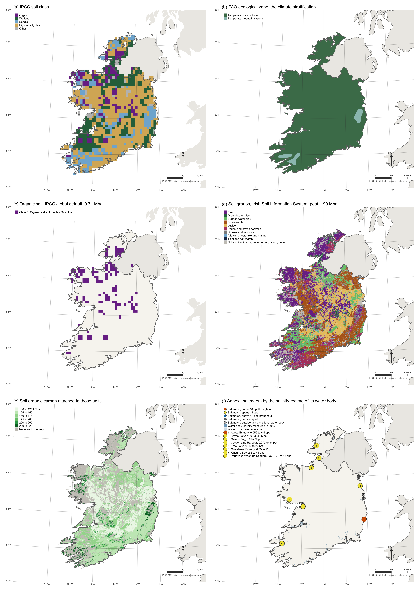
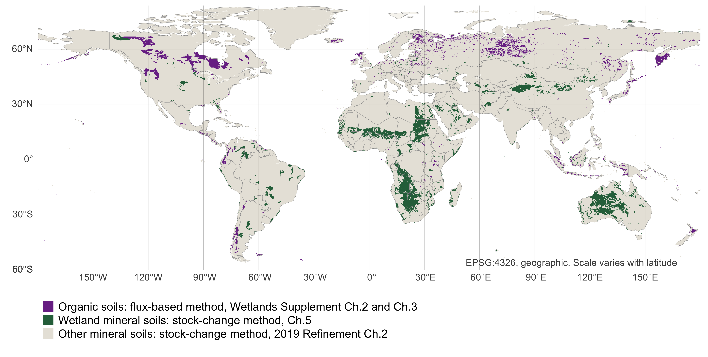

# Soil carbon gains and offsets under updated IPCC Tier 1 methods for organic soils, coastal wetlands and improved grasslands

*Stock-change and flux-based GHG accounting of Irish country-level datasets*

## Abstract

Since 2013, the IPCC Guidelines have allowed a country to report a soil carbon removal when it rewets drained peatland, restores a tidal marsh or mangrove, or improves grassland management. This study asked whether those removals are climate benefits once the methane and nitrous oxide emitted from the same land are counted. The default emission factors and reference stocks were encoded, and the emissions after rewetting were subtracted from those of continued drainage across thirteen cases. The gases were weighted at hundred-year and twenty-year global warming potentials, and the published 95 per cent ranges were propagated by Monte Carlo. Three problems were found. First, whether rewetting reduced or increased warming depended on the horizon chosen, not on the emission factors. Five of thirteen peatland cases changed sign between GWP100 and GWP20, and the same five fell below a 0.95 probability of benefit at GWP100. Second, the default reference stocks lay above the median of their source profiles in 34 of 37 cells, by 13 per cent at the median. A typical soil therefore held less carbon than its default. The printed range described the precision of a global mean, not the distance of any site from it. Third, Ireland's country-specific emission factors showed the defaults biased in opposite directions for carbon dioxide and methane on the same land. Therefore, this study suggests that soil carbon removals, as reported in national inventories, may not represent evidence of true climate benefits. Yet, IPCC guidance remains lacking on testing such outcomes separately.

## Figures

**Figure 1.** The Irish spatial inputs, six maps on one scale in EPSG:2157. (a) The 5 arc-minute IPCC soil classification derived from the Harmonised World Soil Database, clipped to the Republic of Ireland, which selects the soil class of the reference stock. (b) FAO Global Ecological Zones 2010, the climate stratification, which selects the climate zone. (c) Cells classified organic in the same IPCC layer, 0.71 Mha, the area to which the global default applies the flux-based method. (d) Soil groups of the Irish Soil Information System at 1:250,000, collapsed from its plain-English classes, with peat at 1.90 Mha and the two gleys marking the wetland mineral soils of the Chapter 5 method. (e) The soil organic carbon value attached to each unit of the same map, with unattributed area in grey. (f) Confirmed Annex I saltmarsh drawn at polygon centroids, sized by area and coloured by the salinity regime of the transitional water body containing it, over the Water Framework Directive transitional network shaded by whether Inland Fisheries Ireland measured it in 2015, with the eight measured systems numbered; Tralee Bay, the only system above 18 ppt throughout, is a coastal water body absent from this layer.

**Figure 2.** Benefit of rewetting by land use, climate and nutrient status, at two horizons. Bars left of zero are cases where rewetting increases radiative forcing. The GWP-20 panel is the same emission factors under a different weighting; nothing else changes between them.

**Figure 3.** Annual gain against the years over which it may be claimed. The left panel holds pathways with an end date, on a logarithmic axis. Mangrove and tidal marsh are placed at the years a bare soil takes to reach its Wetlands Supplement Table 4.11 stock ceiling, an upper bound. The right panel holds the pathways with no end date in the guidance, rewetted organic soils and seagrass, which has no published ceiling. Two pathways with the same annual factor are not the same asset if one runs for twenty years and the other to a stock ceiling two centuries away.

**Figure 4.** The soils the Tier 1 gain pathways apply to, from the 5 arc-minute IPCC soil classification. Organic soils carry the flux-based method of Wetlands Supplement Chapters 2 and 3; wetland mineral soils carry the Chapter 5 stock-change method; all other mineral soils fall under the 2019 Refinement Chapter 2 reference stocks. The two coloured classes are the soils this paper’s ledger covers, and the boundary between them is the boundary between the two accounting logics of the guidance.

## Tables

**Table 1.** Monte Carlo on the rewetting benefit, 10,000 triangular draws from the published bounds, at GWP-100. Every term with a published range is sampled on both sides, and terms printed without one, the ditch fraction among them, are held at their defaults. `P(benefit > 0)` is the probability that rewetting reduces net emissions.

| Land use | Zone | Nutrient | Median | 5th percentile | 95th percentile | P(benefit &gt; 0) |
|---|---|---|---|---|---|---|
| Forest Land | Boreal | Poor | -0.44 | -4.48 | 2.35 | 0.417 |
| Forest Land | Boreal | Rich | 0.21 | -7.33 | 5.22 | 0.521 |
| Forest Land | Temperate | Unsplit | -2.64 | -15.89 | 6.60 | 0.348 |
| Forest Land | Tropical | Unsplit | 19.01 | 4.76 | 30.92 | 0.997 |
| Cropland | Temperate | Rich | 22.47 | 9.15 | 32.60 | 1.000 |
| Cropland | Tropical | Unsplit | 58.73 | 36.71 | 85.83 | 1.000 |
| Grassland | Boreal | Unsplit | 24.55 | 16.73 | 32.55 | 1.000 |
| Grassland | Temperate | Poor | 17.81 | 10.06 | 24.08 | 1.000 |
| Grassland (deep-drained) | Temperate | Rich | 14.22 | 0.77 | 23.93 | 0.960 |
| Grassland (shallow-drained) | Temperate | Rich | 1.86 | -11.62 | 12.36 | 0.595 |
| Grassland | Tropical | Unsplit | 39.95 | 25.34 | 57.27 | 1.000 |
| Peat extraction | Temperate | Unsplit | -2.70 | -16.16 | 7.15 | 0.352 |
| Plantation oil palm | Tropical | Unsplit | 41.75 | 27.59 | 56.44 | 1.000 |

**Table 2.** Break-even nitrogen rate and crossover year. Beyond the crossover year the fertilised grassland is a net source in CO2e terms.

| Case | Gain (t CO2 ha-1 yr-1) | Break-even rate (kg N ha-1 yr-1) | Crossover year (at 100 kg N ha-1 yr-1) | Crossover year (at 200 kg N ha-1 yr-1) |
|---|---|---|---|---|
| Lowest gain | 0.92 | 156 | 31 | From year 1 |
| Median gain | 2.98 | 506 | 101 | 51 |
| Highest gain | 6.71 | 1138 | 228 | 114 |

**Table 3.** The soil carbon gain ledger. Gains are maxima across climate and soil class; see the preceding sections for the full matrices.

| Pathway | Source | Max gain (t CO2 ha-1 yr-1) | Inventory period | Eligibility gate | Offset |
|---|---|---|---|---|---|
| Mangrove rewetting/revegetation, soil | WS Tb 4.12 | 5.94 | To stock ceiling | Planted/seeded; &gt;=10% canopy | CH4 &lt;18 ppt |
| Tidal marsh rewetting/revegetation, soil | WS Tb 4.12 | 3.34 | To stock ceiling | Planted/seeded; &gt;=10% canopy | CH4 &lt;18 ppt |
| Seagrass reestablishment, soil | WS Tb 4.12 | 1.58 | No published ceiling | Planted/seeded | CH4 &lt;18 ppt |
| Rewetted organic soil, boreal nutrient-rich | WS Tb 3.1 | 2.02 | From year 1, indefinite | Nutrient status | CH4 + DOC |
| Rewetted organic soil, boreal nutrient-poor | WS Tb 3.1 | 1.25 | From year 1, indefinite | Nutrient status | CH4 + DOC |
| Inland wetland mineral soil, rewetting | WS Tb 5.3 | 4.95 | 40 years | None | CH4 |
| Improved grassland, nominal-improved + high input | 2019 Tb 6.2 | 6.71 | 20 years | Improvement applied | N2O if fertilised |
| Improved grassland, degraded-improved + high input | 2019 Tb 6.2 | 14.30 | 20 years | Improvement applied | N2O if fertilised |

**Table 4.** Industrial peat extraction in Ireland, 2024, t CO2e ha-1 yr-1, positive = net source. Built entirely from Ireland’s reported implied emission factors: on-site soil carbon from Table 4.D plus off-site CO2, N2O and CH4 from Table 4(II).

| Metric | Drained | Rewetted | Benefit of rewetting |
|---|---|---|---|
| AR5 GWP-100 | 15.02 | 8.19 | 6.83 |
| AR6 GWP-100 | 15.00 | 7.98 | 7.02 |
| AR6 GWP-20 | 16.19 | 19.08 | -2.89 |
